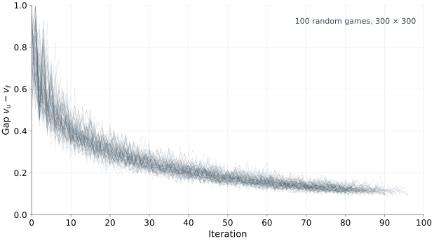
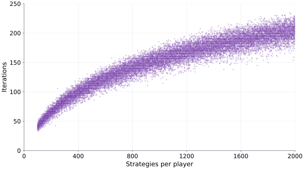

In a two-player zero-sum game, one player's gain is the other player's
loss. The opposite interests makes an elementary solution concept
available: choose a strategy with the best guarantee against any opponent's
strategy. Minimax reasoning starts with these individual guarantees, while
Nash equilibrium asks the more complicated question of whether the players' choices are mutual best responses. We will develop the minimax solution and then prove that the two concepts
agree for finite two-player zero-sum games.

We begin with the example game called Morra, introduce matrix games, and derive the *minimax theorem*
from linear programming duality. We then turn to the *Double Oracle
algorithm*, which solves large games by generating strategies as needed.

## Morra {#sec-zero-sum-morra}

This version of game called Morra is discussed in [@washburn2014]. Alice and Bob simultaneously raise one, two, or three fingers and guess
how many fingers the other player will raise. If exactly one guess is
correct, the correct guesser receives a payment from the other player equal
to the total number of fingers raised. If both guesses are correct, or
both are incorrect, there is no payment.

A pure strategy must specify both a number of fingers and a guess. Write
$i\text{-}j$ for the strategy "raise $i$ fingers and guess $j$." Thus each
player has nine pure strategies. Alice is the row player and Bob is the
column player. Since every payment received by one player is paid by the
other, it suffices to display Alice's payoff:



For example, at $(1\text{-}2,2\text{-}2)$ Alice guesses correctly and Bob
does not, so Alice receives $3$ from Bob. At
$(1\text{-}2,2\text{-}1)$ both guess correctly and both receive $0$. It is easy to check that this game doesn't have a pure Nash equilibrium. The mixed equilibrium exists and it can be computed using some method introduced in the previous lecture. We will show that much more efficient technique is available for matrix games.

## Matrix games {#sec-zero-sum-matrix-games}

::: {.callout-note appearance="minimal" icon="false" title="Definition"}

A **matrix game** is a finite two-player zero-sum normal-form game:
$N=\{1,2\}$, the strategy sets $S_1,S_2$ are finite, and

$$
u_1(s_1,s_2)+u_2(s_1,s_2)=0
\qquad\text{for every }(s_1,s_2)\in\mathbf S.
$$

We write $u=u_1=-u_2$. Player 1 is the **maximizing player** and player 2
is the **minimizing player**, both with respect to $u$.

:::

Only one payoff matrix is needed. Its rows correspond to $S_1$, its
columns to $S_2$, and its entries are $u(s_1,s_2)$. An entry is player 1's
payoff and player 2's loss.

As before, lowercase $u$ denotes utility at a pure
profile and uppercase $U$ denotes expected utility:

$$
U(p_1,p_2)
=\sum_{s_1\in S_1}\sum_{s_2\in S_2}
p_1(s_1)p_2(s_2)u(s_1,s_2).
$$

Thus $U=U_1=-U_2$. Throughout, player 2 minimizes $U$ because
this maximizes their own expected utility $-U$.

## The minimax theorem {#sec-zero-sum-minimax}

### Maximin and minimax values

For a fixed mixed strategy $p_1$, the smallest expected payoff that
player 1 can receive is

$$
\min_{p_2\in\Delta_2}U(p_1,p_2)
=\min_{s_2\in S_2}U(p_1,s_2).
$$

Player 1 chooses $p_1$ to make this guarantee as large as possible.

Similarly, for fixed $p_2$, the largest loss player 2 can incur is

$$
\max_{p_1\in\Delta_1}U(p_1,p_2)
=\max_{s_1\in S_1}U(s_1,p_2).
$$

Player 2 chooses $p_2$ to make this upper bound on their loss as small as
possible.

::: {.callout-note appearance="minimal" icon="false" title="Definition"}

The **maximin value** and **minimax value** are, respectively,

$$
\underline v
=\max_{p_1\in\Delta_1}\min_{s_2\in S_2}U(p_1,s_2), \qquad 
\overline v
=\min_{p_2\in\Delta_2}\max_{s_1\in S_1}U(s_1,p_2).
$$ 

A maximizing choice $p_1^*$ in the first problem is a **maximin strategy**.
A minimizing choice $p_2^*$ in the second is a **minimax strategy**.
A strategy is **optimal** if it is a maximin strategy for player 1 or a
minimax strategy for player 2.

:::

For every $p_1,p_2$,

$$
\min_{s_2\in S_2}U(p_1,s_2)
\leq U(p_1,p_2)
\leq\max_{s_1\in S_1}U(s_1,p_2).
$$

The leftmost quantity depends only on $p_1$ and the rightmost only on
$p_2$. Maximizing the former and minimizing the latter gives the
*weak minimax inequality* $\underline v\leq\overline v$.
The main result of the theory of matrix games is that equality always holds.

### Saddle points

We will look first to the case when the maximin value agree with the minimax value and 
two pure strategies $(s_1^*,s_2^*)$ provide the bounds for guarantees:
$$
\underline v
=\min_{s_2\in S_2}u(s_1^*,s_2)
=\max_{s_1\in S_1}u(s_1,s_2^*)=\overline v.
$$ 
Then the conditions above are equivalent to the pure Nash equilibrium conditions,

$$
u(s_1,s_2^*)\leq u(s_1^*,s_2^*)\leq u(s_1^*,s_2)
\qquad \forall (s_1,s_2)\in \mathbf S.
$$ 

 A profile
$(s_1^*,s_2^*)\in \mathbf S$ is also called a **saddle point**. The entry at a saddle point is a maximum in its column and a minimum in
its row. 

::: {.callout-note appearance="minimal" icon="false" title="Example"}

Consider the  matrix game



The row minima are $1,4,7$, so player 1 can guarantee $7$ by choosing $c$.
The column maxima are $7,8,9$, so player 2 can hold their loss to at most
$7$ by choosing $d$. Hence $(c,d)$ is a saddle point and

$$
\max_{s_1\in S_1}\min_{s_2\in S_2}u(s_1,s_2)
=7=
\min_{s_2\in S_2}\max_{s_1\in S_1}u(s_1,s_2).
$$

:::

Pure saddle points need not exist. In matching pennies, every row contains
a payoff of $-1$ and every column contains a payoff of $1$. Thus 
$$
\max_{s_1\in S_1}\min_{s_2\in S_2}u(s_1,s_2)=-1 < 1=
\min_{s_2\in S_2}\max_{s_1\in S_1}u(s_1,s_2).
$$

By contrast, each player's uniform mixed strategy in matching pennies
guarantees $0$, so $\underline v=\overline v=0$. The gap above arises
from restricting the players to pure strategies.

### The two dual linear programs {#sec-zero-sum-lp}

Both minimax and maximin problems contain an inner optimization. We now encode its
value using an auxiliary variable and linear inequalities. This is the
standard reformulation used in the bachelor's Optimization course
(B0B33OPT) in Open Informatics at CTU's Faculty of Electrical Engineering;
see @werner2026 [Section 12.1.1].

**Player 1: maximizing a minimum.** For each fixed $s_2$, the function

$$
U(p_1,s_2)=\sum_{s_1\in S_1}p_1(s_1)u(s_1,s_2)
$$

is linear in $p_1$. Therefore, the inner minimum
$\min_{s_2\in S_2}U(p_1,s_2)$ is the *pointwise minimum of finitely many
linear functions* of $p_1$. It is concave and piecewise linear, but need
not be linear itself. Player 1's problem is to maximize this function over
$\Delta_1$.

Introduce a variable $v_1$ below this minimum. For every fixed $p_1$,

$$
v_1\leq\min_{s_2\in S_2}U(p_1,s_2)
\quad\Longleftrightarrow\quad
v_1\leq U(p_1,s_2)\quad\forall s_2\in S_2.
$$

The inequalities on the right are linear in $(p_1,v_1)$. They say that
$v_1$ is a lower bound on every expected payoff player 1 could receive. Maximizing
$v_1$ with $p_1$ fixed makes this bound equal to the smallest of those
payoffs: if it were strictly smaller, we could increase $v_1$ without
violating any constraint. Thus

$$
\min_{s_2\in S_2}U(p_1,s_2)
=\max_{v_1\in\mathbb R}
\left\{v_1\mid v_1\leq U(p_1,s_2)\ \forall s_2\in S_2\right\}.
$$

We can now maximize jointly over $p_1\in\Delta_1$ and $v_1$. The inner
minimum has been replaced exactly by one linear inequality for each pure
strategy of player 2.

**Player 2: minimizing a maximum.** Similarly, for each fixed $s_1$,

$$
U(s_1,p_2)=\sum_{s_2\in S_2}p_2(s_2)u(s_1,s_2)
$$

is linear in $p_2$. The inner maximum
$\max_{s_1\in S_1}U(s_1,p_2)$ is the *pointwise maximum of finitely many
linear functions*, hence convex and piecewise linear. Player 2 minimizes
this function over $\Delta_2$.

Introduce an upper bound $v_2$. For every fixed $p_2$,

$$
\max_{s_1\in S_1}U(s_1,p_2)\leq v_2
\quad\Longleftrightarrow\quad
U(s_1,p_2)\leq v_2\quad\forall s_1\in S_1.
$$

Minimizing $v_2$ makes it equal to the largest payoff: a strictly larger
bound could be decreased while preserving every constraint. Consequently,

$$
\max_{s_1\in S_1}U(s_1,p_2)
=\min_{v_2\in\mathbb R}
\left\{v_2\mid U(s_1,p_2)\leq v_2\ \forall s_1\in S_1\right\}.
$$

Minimizing jointly over $p_2\in\Delta_2$ and $v_2$ therefore replaces the
inner maximum exactly by one linear inequality for each pure strategy of
player 1. This is an *epigraph formulation*; the analogous construction
for player 1 is a *hypograph formulation*, using a lower bound instead of
an upper bound.

**Writing the linear programs in matrix notation.** Enumerate
$S_1=\{s_1^1,\ldots,s_1^m\}$ and
$S_2=\{s_2^1,\ldots,s_2^n\}$, and define

$$
A\in\mathbb R^{m\times n},\qquad A_{ij}=u(s_1^i,s_2^j).
$$

In this subsection, identify $p_1,p_2$ with column vectors of probabilities
in these orders, and let $\mathbf 1_k$ denote the all-ones vector of length
$k$. Then

$$
(A^{\mathsf T}p_1)_j=U(p_1,s_2^j),\quad
(Ap_2)_i=U(s_1^i,p_2),\quad
U(p_1,p_2)=p_1^{\mathsf T}Ap_2.
$$

The inequalities $v_1\leq U(p_1,s_2)$ become
$A^{\mathsf T}p_1\geq v_1\mathbf 1_n$. Together with the probability
constraints defining $\Delta_1$, they give player 1's linear program:

$$
\begin{aligned}
\text{maximize}_{p_1,v_1}\quad &v_1\\
\text{subject to}\quad
&A^{\mathsf T}p_1\geq v_1\mathbf 1_n,\\
&\mathbf 1_m^{\mathsf T}p_1=1,\\
&p_1\geq\mathbf 0,\qquad v_1\in\mathbb R.
\end{aligned}
$$ {#eq-zero-sum-lp-maximin}

Likewise, $U(s_1,p_2)\leq v_2$ becomes $Ap_2\leq v_2\mathbf 1_m$.
Adding the constraints defining $\Delta_2$ gives player 2's linear program:

$$
\begin{aligned}
\text{minimize}_{p_2,v_2}\quad &v_2\\
\text{subject to}\quad
&Ap_2\leq v_2\mathbf 1_m,\\
&\mathbf 1_n^{\mathsf T}p_2=1,\\
&p_2\geq\mathbf 0,\qquad v_2\in\mathbb R.
\end{aligned}
$$ {#eq-zero-sum-lp-minimax}

We thus *decouple* the computation of maximin and minimax values into two
 linear programs. By construction, the optimal values are
$\underline v$ and $\overline v$, respectively.  These two linear programs are *dual* to one another. Both programs are feasible: any probability distribution works with a
sufficiently small $v_1$ or sufficiently large $v_2$. Their optimal
objective values are finite because every expected payoff lies between
the smallest and largest entries of the payoff matrix. Strong duality theorem therefore gives equality of the two optimal values.

::: {.callout-important appearance="minimal" icon="false" title="Minimax theorem [@vonneumann1928]"}

Every matrix game satisfies $\underline v=\overline v$.

:::
Thus, maximin and minimax strategies exist. The common quantity $v=\underline v=\overline v$ is the **value of the
game** . 

A Python notebook solving Morra using the two LPs is
[available on GitHub](https://github.com/tomaskroupa/quarto-game-theory-course/blob/main/notebooks/python/04-matrix-games-lp.ipynb)
or can be [opened in Colab](https://colab.research.google.com/github/tomaskroupa/quarto-game-theory-course/blob/main/notebooks/python/04-matrix-games-lp.ipynb).

## Minimax solutions and Nash equilibrium {#sec-zero-sum-nash}

We summarize several equivalent conditions for optimality of strategies in matrix games.

::: {.callout-important appearance="minimal" icon="false" title="Proposition"}

For a mixed strategy profile $(p_1^*,p_2^*)$ in a matrix game, the following
conditions are equivalent:

1. $p_1^*$ is a maximin strategy and $p_2^*$ is a minimax strategy.
2. $(p_1^*,p_2^*)$ is a Nash equilibrium, that is,

   $$
   U(p_1,p_2^*)\leq U(p_1^*,p_2^*)\leq U(p_1^*,p_2)
   \qquad\text{for every }(p_1,p_2)\in\boldsymbol\Delta.
   $$

3. The same inequalities hold for all pure deviations:

   $$
   U(s_1,p_2^*)\leq U(p_1^*,p_2^*)\leq U(p_1^*,s_2)
   \qquad\text{for every }(s_1,s_2)\in\mathbf S.
   $$

4. The best-response payoffs satisfy

   $$
   \max_{s_1\in S_1}U(s_1,p_2^*)
   =U(p_1^*,p_2^*)
   =\min_{s_2\in S_2}U(p_1^*,s_2).
   $$

If any of these conditions holds, then $U(p_1^*,p_2^*)=v$.

:::

*Proof.* If both strategies are optimal, then, for every $p_1,p_2$,

$$
U(p_1,p_2^*)\leq v\leq U(p_1^*,p_2).
$$

Taking $p_1=p_1^*$ and $p_2=p_2^*$ shows that
$U(p_1^*,p_2^*)=v$, proving that $(p_1^*,p_2^*)$ is a Nash equilibrium.

Conversely, suppose $(p_1^*,p_2^*)$ is a Nash equilibrium and put
$w=U(p_1^*,p_2^*)$. Therefore

$$
\max_{p_1\in\Delta_1}U(p_1,p_2^*)=w=\min_{p_2\in\Delta_2}U(p_1^*,p_2).
$$

Hence $\overline v\leq w\leq \underline v$. Together with
$\underline v\leq\overline v$, this yields
$\underline v=w=\overline v$, so both strategies are optimal.
The equivalence with pure deviations follows from
@sec-mixed-pure-deviations. Taking the maximum and minimum in those
inequalities gives condition 4, and condition 4 immediately implies
condition 3. $\square$

Several consequences follow.

- All equilibria $(p_1^*,p_2^*)$ have the same payoff pair $(v,-v)$.
- Optimal strategies need not be unique. Any maximin strategy can be
  paired with any minimax strategy to form an equilibrium, so that
  strategies from different equilibria are *interchangeable*.
- There is no equilibrium-selection problem concerning payoffs or the
  compatibility of independently selected optimal strategies.

We emphasize that the equality $U(p_1,p_2)=v$ *alone* is insufficient for equilibrium. In matching pennies,
Alice playing $H$ against Bob's uniform mixture gives expected payoff
$0=v$, but Bob can improve by switching to $T$. What matters is the pair
of guarantees against all deviations.

## Solving Morra {#sec-zero-sum-morra-solution}

Recal the game of Morra from @sec-zero-sum-morra. The linear programs give $v=0$. One optimal
strategy for each player is

$$
p_i^*(1\text{-}3)=\frac5{12},\qquad
p_i^*(2\text{-}2)=\frac4{12},\qquad
p_i^*(3\text{-}1)=\frac3{12},
$$

with probability zero on the other six strategies. 

We can verify the solution directly. If player 1 uses $p_1^*$, their
expected payoffs against player 2's pure strategies are:

| Player 2's pure strategy $s_2$ | $U(p_1^*,s_2)$ |
|:--|:--:|
| $1\text{-}1$ or $3\text{-}3$ | $1/6$ |
| $2\text{-}1$ or $2\text{-}3$ | $1/12$ |
| $1\text{-}2$, $1\text{-}3$, $2\text{-}2$, $3\text{-}1$, or $3\text{-}2$ | $0$ |

Every entry is nonnegative, so player 1 guarantees at least $0$.
The game is symmetric between the players and
$u(s_1,s_2)=-u(s_2,s_1)$. Consequently, when player 2 uses the same
probabilities, $U(s_1,p_2^*)\leq0$ for every pure strategy $s_1$.
Player 2 therefore guarantees a loss of at most $0$. This verifies both
optimality and the value $v=0$.

Notice that some unused strategies also give payoff $0$. As discussed in
@sec-mixed-support-condition, a best response need not belong to the
support of the equilibrium strategy.

## Penalty kicks {#sec-zero-sum-penalty-kicks}

The penalty-kick example comes from Ignacio Palacios-Huerta's study
*Professionals Play Minimax*, based on $1\,417$ professional soccer penalties
[@palacioshuerta2003]. Player 1 is the *kicker*, who chooses where to
shoot, and player 2 is the *goalkeeper*, who chooses where to jump. We model
their choices as simultaneous.

Each player chooses $u$ (the kicker's *unnatural side*) or $n$ (the
kicker's *natural side*, determined by their kicking foot). Both labels
refer to the same side of the goal for both players. Following the paper'sß
two-action coding, centre choices are grouped with the natural side.

Let the matrix entries be the probability of scoring for the chosen pair of
directions. Rows are the kicker's choices and columns the goalkeeper's choices:



The entries are the paper's empirical scoring probabilities rounded to
two decimal places [@palacioshuerta2003]. For example,
$0.95$ is a scoring probability when the kicker shoots
to the unnatural side and the goalkeeper chooses the natural side.

### Optimal strategies and the scoring guarantee

There is no pure saddle point: the kicker prefers the side opposite the
goalkeeper's choice, while the goalkeeper prefers to match the kicker's
choice. Let $x$ be the probability that the kicker selects $u$ and $y$ by the probablity that the goalkeeper also picks $u$. The kicker's maximin problem is

$$
\max_{0\leq x\leq1}
\min\{0.58x+0.93(1-x),\;0.95x+0.70(1-x)\}.
$$

The first expression decreases with $x$ and the second increases. Their
minimum is largest where their graphs meet:

$$
x^*=\frac{23}{60}\approx0.3833.
$$

Likewise, the goalkeeper solves

$$
\min_{0\leq y\leq1}
\max\{0.58y+0.95(1-y),\;0.93y+0.70(1-y)\}.
$$

We get

$$
y^*=\frac5{12}\approx0.4167.
$$
The observed
frequencies are $39.98\%$ and $42.31\%$, respectively
[@palacioshuerta2003].

The optimal strategies $x^*$ and $y^*$ give the value of the game

$$
v
=\frac{191}{240}\approx0.7958.
$$

Thus the kicker guarantees a scoring probability of at least
$v$ and the goalkeeper holds it to at most the same value. 

## Comparison with general-sum games {#sec-zero-sum-computation}

The maximizing player's LP has $m+1$ variables and $n$ payoff
inequalities; the minimizing player's LP has $n+1$ variables and $m$
payoff inequalities. For rational input payoffs, linear programming gives
a solution in time polynomial in the bit length of the explicit payoff
matrix. This is a special computational advantage of matrix games.

The comparison below concerns finite two-player games.

| Property | Zero-sum games | General-sum games |
|:--|:--|:--|
| Mixed Nash equilibrium | Always exists | Always exists |
| Maximin/minimax strategies and Nash equilibrium | Equivalent | Generally different |
| Equilibrium payoffs | The unique pair $(v,-v)$ | May differ across equilibria |
| Strategies from different equilibria | Interchangeable | Need not form an equilibrium |
| Computational method | A pair of dual LPs | Coupled best-response conditions; no known polynomial-time algorithm |

## Double Oracle algorithm {#sec-zero-sum-double-oracle}

### Why the full matrix may be too large {#sec-zero-sum-do-motivation}

Polynomial time in the size of an explicitly listed matrix is not enough
when even listing that matrix is impractical. For example, a pure strategy may itself
be a complete allocation of resources, with an enormous number of such
allocations available to each player.

::: {.callout-note appearance="minimal" icon="false" title="Example: Colonel Blotto"}

Consider the discrete **Colonel Blotto game**, which is a standard model of
competitive resource allocation [@vu2018]. Alice and Bob each distribute
$B$ indivisible units across $k$ locations. They choose simultaneously,
without seeing the other's allocation. At each location, the player
allocating more units wins and equal allocations tie.

We measure Alice's payoff as the number
of locations she wins minus the number Bob wins. Bob receives its
negative. Formally,

$$
S_i=\left\{s_i\in\mathbb Z_{\geq0}^{k}\mid
\sum_{j=1}^{k}s_{ij}=B\right\},\qquad
u(s_1,s_2)=\sum_{j=1}^{k}\operatorname{sgn}(s_{1j}-s_{2j}).
$$

Each player has $\binom{B+k-1}{k-1}$ pure strategies. For $B=50$ and
$k=10$, this is $12\,565\,671\,261$ allocations per player, giving more
than $10^{20}$ entries in the full payoff matrix.

:::

A useful alternative is to start with a few allocations, solve the
restricted game, and ask each player for a best response in the *full*
strategy set. A best response supplies a missing row or column.
The procedure used to compute such a response is called an **oracle**.
It can exploit the structure of the allocation problem instead of
enumerating all allocations.

For example, against a mixed strategy $q_2$ over a small set $T_2\subset S_2$, define the
expected contribution of allocating $b$ units to location $j$ by

$$
r_j(b)=\sum_{s_2\in T_2}q_2(s_2)
\operatorname{sgn}(b-s_{2j}).
$$

Player 1's best-response problem becomes

$$
\max_{s_1\in S_1}U(s_1,q_2)
=\max_{s_1\in S_1}\sum_{j=1}^{k}r_j(s_{1j}).
$$

This is a discrete resource-allocation problem. Dynamic programming over locations and remaining budget finds one maximizing allocation [@vu2018]. Player
2 has an analogous problem.  

### The algorithm {#sec-zero-sum-do-algorithm}

The general Double Oracle
method was introduced by @mcmahan2003.
Choose nonempty subsets $T_1\subseteq S_1$ and $T_2\subseteq S_2$.
The **restricted game** retains the original payoffs but allows only
strategies in $T_1,T_2$. A mixed strategy in this game is viewed as a
strategy in the full game by assigning probability zero outside $T_i$.

::: {.callout-note appearance="minimal" icon="false" title="Algorithm: Double Oracle"}

**Input:** A matrix game, small nonempty sets $T_1,T_2$, and exact
pure best-response oracles for both players.

1. **Solve the restricted game.** Compute an equilibrium
   $(q_1^*,q_2^*)$ using the two linear programs restricted to $T_1,T_2$.
2. **Compute full-game best responses.** Choose

   $$
   s_1\in\underset{t_1\in S_1}{\operatorname{argmax}}U(t_1,q_2^*),
   \qquad
   s_2\in\underset{t_2\in S_2}{\operatorname{argmin}}U(q_1^*,t_2).
   $$

3. **Check termination.** If $s_1\in T_1$ and $s_2\in T_2$, return
   $(q_1^*,q_2^*)$.
4. **Expand the restricted game.** Set
   $T_1\leftarrow T_1\cup\{s_1\}$ and
   $T_2\leftarrow T_2\cup\{s_2\}$, and repeat.

:::

Notice that the maximization and minimization in step 2 range over the strategy sets $S_1$ and $S_2$ in the full game. Solving the restricted game guarantees that no currently
included strategy is a profitable deviation. The oracles check the
missing strategies. Each expansion adds any new responses returned by
the oracles.

### A small Blotto run

Take $B=3$ and $k=3$ in the Blotto game from @sec-zero-sum-do-motivation. Each player has ten
allocations. Name four of them

$$
a=(3,0,0),\quad b=(0,1,2),\quad
c=(1,2,0),\quad d=(2,0,1).
$$

Start with $T_1=T_2=\{a\}$. In the following valid run, both players
use the same restricted-game strategy and both oracles return the same
allocation. When best responses tie, we select the one displayed.

| Iteration | $T_1=T_2$ | Restricted-game strategy of each player | Full-game response returned by each oracle |
|--:|:--|:--|:--|
| 1 | $\{a\}$ | Pure $a$ | $b$ |
| 2 | $\{a,b\}$ | Pure $b$ | $c$ |
| 3 | $\{a,b,c\}$ | Pure $c$ | $d$ |
| 4 | $\{a,b,c,d\}$ | Uniform on $\{b,c,d\}$ | $b$; stop |

For instance, $b$ loses the first location to $a$ but wins the other two,
so $u(b,a)=1$. The next two expansions follow from
$u(c,b)=1$ and $u(d,c)=1$. The allocations $b,c,d$ form a cycle:
each beats one of the others and loses to the third.

At iteration 4, each player uses $b,c,d$ with probability $1/3$.
Against this mixture, any allocation putting all three units at one
location gives player 1 expected payoff $-1/3$. Each of the other seven
allocations gives $0$. Thus a full-game best response achieves $0$;
by symmetry, player 2 can also hold the payoff to $0$. The algorithm has
found an equilibrium of the ten-strategy game using only a
four-strategy restricted game. In particular, checking the other six
allocations is what makes the conclusion valid for the full game.

### Termination and correctness {#sec-zero-sum-do-correctness}

Let $v$ be the value of the full matrix game. At a given iteration define

$$
\begin{aligned}
v_u&=U(s_1,q_2^*)=\max_{t_1\in S_1}U(t_1,q_2^*),\\
v_\ell&=U(q_1^*,s_2)=\min_{t_2\in S_2}U(q_1^*,t_2).
\end{aligned}
$$ 

Then

$$
v_\ell\leq v\leq v_u.
$$

Indeed, $q_1^*$ is one feasible choice in player 1's maximin problem, so
its guarantee cannot exceed $v$. Similarly, $q_2^*$ is one feasible
choice in player 2's minimax problem, so its worst-case loss cannot be
less than $v$. The same bounds apply to the current value of the game: 

$$
v_\ell\leq U(q_1^*,q_2^*)\leq v_u.
$$ 

::: {.callout-important appearance="minimal" icon="false" title="Proposition"}

Double Oracle terminates after finitely many iterations and returns a
Nash equilibrium of the full matrix game.

:::

*Proof.* Every nonterminal iteration adds at least one previously absent
pure strategy. The strategy sets are finite. Hence the
algorithm eventually terminates.

The algorithm stops in step 3 only when both full-game best responses
$s_1,s_2$ returned in step 2 already belong to the current restricted
strategy sets $T_1$ and $T_2$, respectively. Because $(q_1^*,q_2^*)$ is a Nash equilibrium in the restricted game,

$$
U(q_1^*,q_2^*)
=\max_{t_1\in T_1}U(t_1,q_2^*)
=\max_{t_1\in S_1}U(t_1,q_2^*)=v_u.
$$

The second equality uses the fact that a full-game best response $s_1$ is
already in $T_1$. Similarly, $s_2\in T_2$ implies
$U(q_1^*,q_2^*)=v_\ell$. Therefore
$v_\ell=v=v_u=U(q_1^*,q_2^*)$, and the best-response characterization
in @sec-zero-sum-nash proves that $(q_1^*,q_2^*)$ is a Nash equilibrium of the full game. $\square$

Finite termination does not imply that the restricted game will
stay small. In the worst case, many strategies or even the full strategy sets $S_1,S_2$ may be generated. The
method is useful when the restricted games remain manageable and the
oracles can find best responses efficiently.

### An approximate stopping condition {#sec-zero-sum-do-approximation}

For a tolerance $\epsilon\geq0$, an alternative is to stop when

$$
v_u-v_\ell\leq\epsilon.
$$ {#eq-cond-eps-Nash-DO}

The difference $v_u-v_\ell\geq 0$ is called the **gap**. The condition ([-@eq-cond-eps-Nash-DO]) certifies an $\epsilon$-Nash equilibrium $(q_1^*,q_2^*)$ of the full game in the sense
of @sec-computing-regret:
$$
U(p_1,q_2^*)-\epsilon
\leq U(q_1^*,q_2^*)
\leq U(q_1^*,p_2)+\epsilon, \qquad \forall (p_1,p_2)\in\boldsymbol\Delta.
$$ {#eq-eps-Nash-def}

 To see this, let
$\mathbf q^*=(q_1^*,q_2^*)$. Because $U_2=-U$, the players' deviation
incentives are

$$
\begin{aligned}
\delta_1(\mathbf q^*)&=v_u-U(q_1^*,q_2^*),\\
\delta_2(\mathbf q^*)&=U(q_1^*,q_2^*)-v_\ell.
\end{aligned}
$$

Both are nonnegative, and their sum is $v_u-v_\ell$. Therefore the
stopping condition ([-@eq-cond-eps-Nash-DO]) implies $\delta(\mathbf q^*)\leq\epsilon$, which is equivalent to ([-@eq-eps-Nash-def]).

For numerical computation, a positive tolerance is more practical than
testing exact equality. The certificate requires full-game best-response
values: an approximate response without a bound on its error need not
give valid $v_\ell,v_u$.

### Computational experiments {#sec-zero-sum-do-experiments}

The experiments and graphs below were produced by Tomáš Votroubek: [MatrixOracle.jl](https://github.com/votroto/MatrixOracle.jl) repository
provides a Julia implementation of the Double Oracle algorithm for
strategic games, including two-player zero-sum matrix games.

{#fig-zero-sum-do-convergence width=100% fig-alt="One hundred gap trajectories on 300 by 300 random matrix games."}

The first experiment tracks the gap as Double Oracle expands the
restricted game. The gap generally decreases, although an individual
trajectory may oscillate between iterations. 

{#fig-zero-sum-do-size width=100% fig-alt="Scatter plot of matrix size up to 2000 strategies per player against iteration count up to about 230."}

The second experiment shows how the iteration count varies with the
number of strategies. Larger tested games generally require more
iterations. Computational time also depends on the cost of each
iteration, which solves a restricted game and calls two best-response
oracles. These observations describe only the tested instances and do not
establish a worst-case complexity bound.
