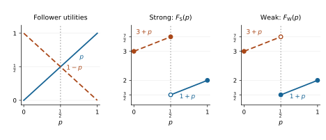

Nash equilibrium assumes that players choose their strategies independently and best respond to one another. In this lecture, we examine *how strategic behavior changes when players can commit before others act or receive information that coordinates their choices.*

In a *Stackelberg game*, a leader commits to a strategy and a follower responds after observing that commitment. Stackelberg's original motivation was competition between firms: one firm chooses its production quantity first, anticipating its rival's response [@stackelberg1934]. We extend this idea to commitments to mixed strategies, focusing on two-player games and the role of tie-breaking when the follower has several best responses.

Security scheduling provides a practical application. A defender commits to a randomized security policy while anticipating an attacker's response. The ARMOR system used this approach to schedule checkpoints and canine patrols at Los Angeles International Airport [@pita2008].

In a *correlated equilibrium*, players receive private recommendations drawn from a joint distribution. A recommendation can provide information about the other players' recommendations, yet no player benefits from disobeying it when the others follow theirs.

Our main focus is computation: we develop linear programming methods for finding an optimal Stackelberg commitment and a correlated equilibrium.

## Commitment and randomized auditing {#sec-stackelberg-commitment}

We adapt the inspection game of [@vonstengel2004, Figure 2], with
rows and columns reordered. The platform plays the inspector and the
cloud service the inspectee; the payoffs are those of the published game.

::: {.callout-note appearance="minimal" icon="false" title="Example"}

A *platform* relies on a *cloud service*. The
platform can audit its result and the service can perform the work honestly
or cheat. An audit costs resources, while cheating harms the platform
even if it is detected. Detection penalizes the service.



If both players choose simultaneously, the unique Nash equilibrium audits
with probability $1/10$ and cheats with probability $1/5$. Indeed, if $p$
is the audit probability and $q$ the cheating probability, the indifference principle requires

$$
1-10p=0,\qquad -1-5q=-10q.
$$

Then the platform's expected utility is $-2$ and the service's is $0$.

:::

Suppose instead that the platform deploys a verifiable randomized audit
policy. The service observes the *probability* of an audit before
deciding whether to cheat, but does not observe the realized audit
decision. The platform must implement the committed policy.

More generally, consider a finite two-player game. Player 1 is the
**leader** and player 2 the **follower**. Write

$$
\operatorname{BR}_2(p_1)=\underset{s_2\in S_2}{\operatorname{argmax}}U_2(p_1,s_2).
$$

The game proceeds as follows:

1. The leader publicly commits to a mixed strategy $p_1\in\Delta_1$.
2. The follower observes $p_1$, but not the sampled action, and chooses
   a best response from $\operatorname{BR}_2(p_1)$.
3. The leader's action is sampled from $p_1$ and payoffs are realized.

A mixed best response is supported on $\operatorname{BR}_2(p_1)$.
Since the leader's payoff is linear in the follower's mixture, its best
and worst values over these responses are attained by pure responses.
Thus pure follower responses suffice for the two conventions below.

## Weak and strong Stackelberg equilibrium {#sec-stackelberg-ties}

The follower maximizes their own utility. If several best responses of the follower tie,
they can give different payoffs to the leader. We can now apply two conventions. The strong (optimistic) convention breaks ties *in favor of the leader*; the weak (pessimistic)
convention breaks them *against the leader*.  Define

$$
F_{\mathrm S}(p_1)=\max_{s_2\in \operatorname{BR}_2(p_1)}U_1(p_1,s_2),
\qquad
F_{\mathrm W}(p_1)=\min_{s_2\in \operatorname{BR}_2(p_1)}U_1(p_1,s_2).
$$

::: {.callout-note appearance="minimal" icon="false" title="Definition"}

A **strong Stackelberg equilibrium** (SSE) is a pair $(p_1^*,s_2^*)$ such that

$$
p_1^*\in\underset{p_1\in\Delta_1}{\operatorname{argmax}} F_{\mathrm S}(p_1),
\qquad
s_2^*\in\underset{s_2\in \operatorname{BR}_2(p_1^*)}{\operatorname{argmax}}U_1(p_1^*,s_2).
$$

A **weak Stackelberg equilibrium** (WSE) is a pair $(p_1^*,s_2^*)$ such that

$$
p_1^*\in\underset{p_1\in\Delta_1}{\operatorname{argmax}} F_{\mathrm W}(p_1),
\qquad
s_2^*\in\underset{s_2\in \operatorname{BR}_2(p_1^*)}{\operatorname{argmin}} U_1(p_1^*,s_2).
$$

:::

These conventions for tie breaking and their
existence implications for Stackelberg equilibria are discussed in [@conitzer2006; @vonstengel2004]. If the follower has a unique best response to a commitment $p_1$, there
is no tie to break, so $F_{\mathrm S}(p_1)=F_{\mathrm W}(p_1)$. If this
holds for every commitment, the leader faces the same optimization
problem under both conventions,
$$
\max_{p_1\in \Delta_1} U_1(p_1,s_2(p_1)), \qquad \text{where } \operatorname{BR}_2(p_1)=\{s_2(p_1)\}.
$$
Thus, SSE and WSE coincide in this particular case.

### The geometry of a tie

Consider this game from [@conitzer2006].

::: {.callout-note appearance="minimal" icon="false" title="Example"}



For the row player, $a$ strictly dominates $b$, so the only 
Nash equilibrium is $(a,c)$ with leader's payoff $2$. But a commitment to
$b$ induces $d$ and gives the leader $3$. Committing to an action changes
the follower's response, which explains why a dominated action can be
useful here.

Let $p=p_1(a)$. Then

$$
U_2(p_1,c)=p,\qquad U_2(p_1,d)=1-p,
$$

whereas $U_1(p_1,c)=1+p$ and $U_1(p_1,d)=3+p$. Hence

$$
\operatorname{BR}_2(p_1)=
\begin{cases}
\{d\},&p<1/2,\\
\{c,d\},&p=1/2,\\
\{c\},&p>1/2.
\end{cases}
$$

At $p=1/2$, the follower receives $1/2$ from either action, but the
leader receives $7/2$ from $d$ and $3/2$ from $c$. Thus

$$
F_{\mathrm S}(p_1)=
\begin{cases}3+p,&p\le1/2,\\1+p,&p>1/2,\end{cases}
\qquad
F_{\mathrm W}(p_1)=
\begin{cases}3+p,&p<1/2,\\1+p,&p\ge1/2.\end{cases}
$$

:::

{#fig-stackelberg-commitment width=100% fig-alt="Follower utility lines cross at p=1/2. The strong leader payoff attains 7/2 there, whereas the weak payoff equals 3/2 there and only approaches the supremum 7/2."}

Thus, the SSE is given by $p^*=1/2$ and $s_2^*=d$. By contrast, the WSE does not exist since the weak problem has *no
maximizer*. Its optimal value is 

$$
\sup_{p_1\in\Delta_1}F_{\mathrm W}(p_1)=7/2.
$$

Choosing $p=1/2-\varepsilon$
for $0<\varepsilon<1/2$ induces $d$ uniquely and gives the leader payoff $7/2-\varepsilon$, which is an approximation to the supremum. Note that the commitment of a leader to a mixed strategy increases the leader's expected payoff compared to the situation when the strategies were selected independently.

## Computing SSE {#sec-stackelberg-lp}

The leader's optimization problem is 
$$
\max_{p_1\in\Delta_1}\max_{s_2\in \operatorname{BR}_2(p_1)}U_1(p_1,s_2).
$$
This is an instance of *bilevel optimization*: the leader optimizes their commitment subject to the follower choosing a best response. Such problems can be difficult because the best response may change abruptly, making the leader’s induced payoff discontinuous, as illustrated in @fig-stackelberg-commitment. The nesting of optimization problems can be removed by *fixing the follower action first* [@conitzer2006].

::: {.callout-note appearance="minimal" icon="false" title="Commitment algorithm"}

For each $s_2\in S_2$, solve the LP:

$$
\begin{aligned}
\max_{p_1}\quad&
U_1(p_1,s_2)\\
\text{subject to}\quad&
U_2(p_1,s_2)\ge U_2(p_1,t_2)
&&\qquad\forall t_2\in S_2\setminus\{s_2\},\\
&\sum_{s_1\in S_1}p_1(s_1)=1,\quad p_1(s_1)\ge0
&&\qquad\forall s_1\in S_1.
\end{aligned}
$$ 
Discard infeasible LPs. Among the remaining LPs, select one with the
largest optimal value and return its optimal pair $(p_1^*,s_2^*)$.
::: 

The expected payoff inequalities say exactly that $s_2\in \operatorname{BR}_2(p_1)$.
For a fixed $s_2$, the objective and constraints are linear in $p_1$,
since $U_i(p_1,s_2)=\sum_{s_1\in S_1}p_1(s_1)u_i(s_1,s_2)$.

::: {.callout-important appearance="minimal" icon="false" title="Proposition"}

The output $(p_1^*,s_2^*)$ of the commitment algorithm is an SSE.

:::

*Proof.* Every commitment $p_1$ has a follower best response $s_2$ and is
therefore feasible for the LP associated with $s_2$. Thus at least one
LP is feasible. Each feasible region
is a closed subset of the simplex, so its linear objective attains a
maximum. Moreover,

$$
\max_{p_1\in\Delta_1}\max_{s_2\in \operatorname{BR}_2(p_1)}U_1(p_1,s_2)
=\max_{s_2\in S_2}\max_{\substack{p_1\in\Delta_1\\s_2\in \operatorname{BR}_2(p_1)}}
U_1(p_1,s_2),
$$

where infeasible inner problems are omitted. The right-hand side is
exactly the commitment algorithm. If another best response to $p_1^*$
gave the leader more than $s_2^*$, that pair would be feasible in its own
LP and contradict the selected value's optimality. Hence the returned
response also satisfies strong tie-breaking. $\square$

There are $|S_2|$ LPs, each with $|S_1|$ probability variables. With
rational payoffs, the algorithm runs in polynomial time in the bit
length of the explicitly given payoff tables [@conitzer2006, Theorem 2].

For the
game in @fig-stackelberg-commitment, the $c$-branch maximizes $1+p$ over
$p\ge1/2$, giving $2$; the $d$-branch maximizes $3+p$ over $p\le1/2$,
giving $7/2$. The algorithm selects the latter.

### SSE in auditing example

Return to the [inspection game](#sec-stackelberg-commitment). With audit
probability $p$, the service's utilities are $1-10p$ for cheating and $0$
for honesty. The two LPs reduce to

| Response | Constraint | Maximize | Optimal $p$ | Value |
|:--|:--|:--|:--|:--|
| Honest | $p\ge1/10$ | $-p$ | $1/10$ | $-1/10$ |
| Cheat | $p\le1/10$ | $-10+4p$ | $1/10$ | $-48/5$ |

In both rows, $0\le p\le1$. Strong tie-breaking selects honesty at
$p=1/10$. The leader receives $-0.1$, compared with $-2$ in the
 Nash equilibrium. The audit probability is unchanged, but
the service's response changes.

Under weak tie-breaking,

$$
F_{\mathrm W}(p_1)=
\begin{cases}
-10+4p,&p\le1/10,\\
-p,&p>1/10.
\end{cases}
$$

Its supremum is $-1/10$, but it is not attained. This example also shows how the numerical implementation is sensitive to tie breaking, since rounding the commitment can change the response discontinuously:

| Audit probability | Response | Leader utility |
|:--:|:--|:--:|
| $0.099$ | Cheat  | $-9.604$ |
| $0.100$ | Honest under strong tie-breaking | $-0.100$ |
| $0.100$ | Cheat under weak tie-breaking | $-9.600$ |
| $0.101$ | Honest  | $-0.101$ |

We can address both the incentive and numerical issues by choosing a
commitment that makes honesty strictly preferable with an
incentive margin $\delta > 0$. Replace the follower's best-response constraint by

$$
U_2(p_1,\mathrm{Honest})\ge
U_2(p_1,\mathrm{Cheat})+\delta
\quad\Longleftrightarrow\quad
p\ge\frac{1+\delta}{10}.
$$

For $0<\delta\le9$, the least-cost commitment has
$p=(1+\delta)/10$. This has two benefits:

- *Strict incentives:* at this audit probability, the service’s payoff from honesty exceeds its payoff from cheating by $\delta>0$. Honesty is therefore the unique best response, and no tie-breaking rule is needed.
- *Numerical robustness:* suppose solver and rounding errors change the audit probability by at most $\varepsilon$, so that $|\widetilde p-p|\le\varepsilon$. Since the intended probability $p$ gives honesty a payoff advantage of $\delta$, the implemented probability $\widetilde p$ gives an advantage of at least

  $$
  10\widetilde p-1\ge\delta-10\varepsilon.
  $$

  Choosing $\delta>10\varepsilon$ keeps this advantage strictly positive. Honesty therefore remains the unique best response even after these numerical errors.

The platform pays for this buffer as its expected audit cost increases
from $1/10$ to $(1+\delta)/10$. In general, a perturbation need not remove all ties, for
example when two follower actions have identical payoffs against every
leader action.

## Stackelberg equilibrium in matrix games {#sec-stackelberg-zero-sum}

In a two-player zero-sum game, ties between the follower's best responses also give
the same payoff to the leader. This yields the following connection with
the minimax theorem of @sec-zero-sum-minimax.

::: {.callout-important appearance="minimal" icon="false" title="Proposition"}

In a finite matrix game with value $v$, the strong and weak Stackelberg
leader strategies form exactly the set of maximin strategies of player 1.
Both Stackelberg values equal $v$.

:::

*Proof.* For every $p_1\in\Delta_1$,

$$
\operatorname{BR}_2(p_1)=\underset{s_2\in S_2}{\operatorname{argmax}}[-U(p_1,s_2)]
=\underset{s_2\in S_2}{\operatorname{argmin}}U(p_1,s_2).
$$

Every member of this set therefore gives the leader the same utility,
and

$$
F_{\mathrm S}(p_1)=F_{\mathrm W}(p_1)
=\min_{s_2\in S_2}U(p_1,s_2).
$$

Maximizing over $p_1$ is precisely the maximin problem.
Its optimum is $v$ by the minimax theorem. $\square$

The statement concerns only the strategies of the leader. An arbitrary
follower best response to a maximin strategy need not form a
Nash equilibrium with it. For example, in matching pennies the uniform
leader strategy makes either pure follower action a best response.

## More than two players {#sec-stackelberg-multiple-followers}

One extension of a two-player Stackelberg model has a single leader and several followers who move
simultaneously [@basilico2017]:

1. Player 1 publicly commits to $p_1\in\Delta_1$.
2. Players $2,\ldots,n$ observe $p_1$, but not the sampled action, and
   play a Nash equilibrium of the induced game among themselves.
3. Actions are sampled from the chosen mixed strategies and payoffs are realized.

Let $E(p_1)$ be the set of mixed Nash equilibria of this induced game,
and write $\mathbf p_{-1}=(p_2,\ldots,p_n)\in E(p_1)$. Each follower must best respond to
both the commitment and the other followers' strategies. The leader's
optimistic and pessimistic objectives become

$$
F_{\mathrm S}(p_1)=\max_{\mathbf p_{-1}\in E(p_1)}U_1(p_1,\mathbf p_{-1}),
\qquad
F_{\mathrm W}(p_1)=\min_{\mathbf p_{-1}\in E(p_1)}U_1(p_1,\mathbf p_{-1}).
$$

A Stackelberg equilibrium consists of a commitment maximizing the corresponding objective and the followers' Nash equilibrium attaining the maximum or
minimum above. Tie-breaking now means selecting
among Nash equilibria, rather than individual best responses.
Computing these equilibria generally requires nonlinear optimization [@basilico2017].

Another model lets players commit in sequence, observing earlier commitments.
Its behavior is determined recursively by backward induction
with a tie-breaking rule at each stage [@conitzer2006]. Thus the order of
moves and the information observed must be specified.

## Correlated equilibrium {#sec-correlated-equilibrium}

Aumann introduced correlated equilibrium [@aumann1974]. The standard
formulation uses a probability distribution over pure strategy profiles
[@aumann1987]. We start with a simple motivating example.

### Coordination in Bach or Stravinski

Alice prefers Bach, Bob prefers Stravinski, and both prefer attending together.
This payoff matrix motivates correlated
play in [@shoham2008, Section 3.4.5]:



At the mixed Nash equilibrium, Alice chooses $B$ with probability $2/3$
and Bob chooses $B$ with probability $1/3$. Each receives expected utility
$2/3$, so expected social welfare is $4/3$.

A coordinator tosses a fair coin and privately recommends $B$ to each
player on heads and $S$ to each player on tails. The recommendation rule is publicly known, however, so each player can
infer that the other received the same recommendation. If the other
player obeys, following one's own recommendation yields a positive
payoff, whereas choosing the other concert yields zero. Thus neither
player benefits from deviating unilaterally. When both players obey, each receives expected utility $3/2$, giving
total welfare $3$. Both are better off than at the mixed Nash equilibrium.
Total welfare equals that of either pure Nash equilibrium, but the fair
coin divides it equally in expectation.

The joint distribution in this example is

$$
\mu(B,B)=\mu(S,S)=\frac12,\qquad
\mu(B,S)=\mu(S,B)=0.
$$

Both marginal distributions are uniform, but their product
assigns probability $1/4$ to each outcome. Thus
specifying each player's marginal probabilities only would lose the coordination.

### Recommendations and obedience

Consider a finite $n$-player game in which a *coordinator* draws a strategy profile $\mathbf s\in\mathbf S=S_1\times \dots \times S_n$ from a
publicly known distribution $\mu\in\Delta(\mathbf S)$ and privately
recommends $s_i$ to each player $i$. Each player sees only their own
recommendation and is free to choose any strategy in $S_i$.

Write

$$
\mu_i(s_i)=\sum_{\mathbf s_{-i}\in\mathbf S_{-i}}
\mu(s_i,\mathbf s_{-i})
$$

for the probability that player $i$ receives recommendation $s_i$.
Whenever $\mu_i(s_i)>0$, the conditional distribution

$$
\mu(\mathbf s_{-i}\mid s_i)
=\frac{\mu(s_i,\mathbf s_{-i})}{\mu_i(s_i)}
$$

describes the other players' recommendations given that player $i$ is
recommended $s_i$.

::: {.callout-note appearance="minimal" icon="false" title="Definition"}

A distribution $\mu\in\Delta(\mathbf S)$ is a **correlated equilibrium** (CE)
if, for every player $i\in N$ and every $s_i,t_i\in S_i$ with
$\mu_i(s_i)>0$,

$$
\sum_{\mathbf s_{-i}\in\mathbf S_{-i}}
\mu(\mathbf s_{-i}\mid s_i)\,u_i(t_i,\mathbf s_{-i})
\le
\sum_{\mathbf s_{-i}\in\mathbf S_{-i}}
\mu(\mathbf s_{-i}\mid s_i)\,u_i(s_i,\mathbf s_{-i}).
$$

:::

Conditional on their private recommendation, no player can increase
expected utility by choosing another strategy, provided the other
players follow their recommendations. The conditional distribution is
the same on both sides: deviating changes the player's choice, not the
information they received. 

A useful computational test for the correlated equilibrium is the following.

::: {.callout-important appearance="minimal" icon="false" title="Proposition"}

A distribution $\mu\in\Delta(\mathbf S)$ is a correlated equilibrium if
and only if, for every player $i\in N$ and every $s_i,t_i\in S_i$,

$$
\sum_{\mathbf s_{-i}\in\mathbf S_{-i}}
\mu(s_i,\mathbf s_{-i})
\bigl[u_i(s_i,\mathbf s_{-i})-u_i(t_i,\mathbf s_{-i})\bigr]\ge0.
$$ {#eq-ce-obedience}

:::

*Proof.* For any recommendation with $\mu_i(s_i)>0$, substituting the
conditional probabilities and multiplying by $\mu_i(s_i)$ transforms the
definition into the stated inequality, and these steps are reversible.
If $\mu_i(s_i)=0$, every joint probability involving that
recommendation is zero, so the corresponding inequality is $0\ge0$.
$\square$

### Nash equilibrium induces correlated equilibrium

::: {.callout-important appearance="minimal" icon="false" title="Proposition"}

If $\mathbf p^*=(p_1^*,\ldots,p_n^*)$ is a Nash equilibrium of a finite
$n$-player game, then the product distribution

$$
\mu(\mathbf s)=\prod_{i\in N}p_i^*(s_i),
\qquad \mathbf s\in\mathbf S,
$$

is a correlated equilibrium.

:::

*Proof.* Fix a player $i\in N$ and strategies $s_i,t_i\in S_i$.
Write $\mathbf p_{-i}^*$ for the opponents' mixed-strategy profile.
By the product form of $\mu$, the left-hand side of
([-@eq-ce-obedience]) factors as

$$
\begin{aligned}
&\sum_{\mathbf s_{-i}\in\mathbf S_{-i}}
\mu(s_i,\mathbf s_{-i})
\bigl[u_i(s_i,\mathbf s_{-i})-u_i(t_i,\mathbf s_{-i})\bigr]\\
&\qquad=p_i^*(s_i)
\bigl[U_i(s_i,\mathbf p_{-i}^*)-U_i(t_i,\mathbf p_{-i}^*)\bigr].
\end{aligned}
$$

If $p_i^*(s_i)=0$, this expression is zero. Otherwise, the support
condition for Nash equilibrium says that $s_i$ is a best response to
$\mathbf p_{-i}^*$, so the expression in the bracket is nonnegative. This verifies the inequality ([-@eq-ce-obedience]). $\square$

Consequently, every finite game has a correlated equilibrium by Nash's theorem. 

### Computing correlated equilibrium by linear programming

We will confine the computational formulation to the two-player games.
All the constraints ([-@eq-ce-obedience]) are linear in $\mu$.
For a two-player game, adding the probability constraints

$$
\mu(s_1,s_2)\ge0,\qquad
\sum_{s_1\in S_1}\sum_{s_2\in S_2}\mu(s_1,s_2)=1
$$ {#eq-ce-prob}

gives a nonempty and bounded convex polyhedron. Finding any feasible point computes a
correlated equilibrium. To select among them, optimize a linear objective;
for instance, maximizing *expected social welfare* gives the LP

$$
\begin{aligned}
\max_{\mu}\quad&
\sum_{s_1\in S_1}\sum_{s_2\in S_2}
\mu(s_1,s_2)\bigl[u_1(s_1,s_2)+u_2(s_1,s_2)\bigr]\\
\end{aligned}
$$
subject to ([-@eq-ce-obedience]) and ([-@eq-ce-prob]). For an $m\times n$ game there are $mn$ probability variables and
$m(m-1)+n(n-1)$ nontrivial obedience inequalities.

::: {.callout-note appearance="minimal" icon="false" title="Example"}

For Bach or Stravinski, write $x_{BB}=\mu(B,B)$, and similarly for
$x_{BS},x_{SB},x_{SS}$. The first coordinate is Alice's recommendation
and the second is Bob's. In the labels below, $B\to S$ means that a
player is recommended $B$ and considers deviating to $S$. The constraints are

$$
\begin{array}{rcll}
2x_{BB}-x_{BS}&\ge&0 &\text{Alice: }B\to S,\\
x_{SS}-2x_{SB}&\ge&0 &\text{Alice: }S\to B,\\
x_{BB}-2x_{SB}&\ge&0 &\text{Bob: }B\to S,\\
2x_{SS}-x_{BS}&\ge&0 &\text{Bob: }S\to B,\\
x_{BB}+x_{BS}+x_{SB}+x_{SS}&=&1,\\
x_{BB},x_{BS},x_{SB},x_{SS}&\ge&0
\end{array}
$$
The welfare objective is $3(x_{BB}+x_{SS})$. Its maximum is $3$.
The welfare-maximizing correlated equilibria are exactly the distributions
with $\mu(B,B)+\mu(S,S)=1$.

:::
