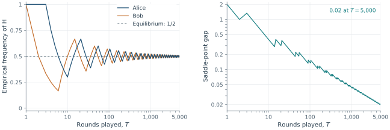

An equilibrium describes mutually consistent behavior. It does not, by itself,
explain how players arrive at that behavior. We now study *repeated interaction*:
players choose strategies, observe feedback, and update their choices. The update
rule and the information available to each player become part of the learning model.

We retain a finite normal-form game
$\left(N,(S_i)_{i\in N},(u_i)_{i\in N}\right)$, with
$\mathbf S=\prod_i S_i$. The same game is played repeatedly, with no change
in its utility functions. As before, $u_i$ denotes
utility at a pure profile and $U_i$ denotes expected utility. 

### From offline computation to online interaction {.unnumbered}

In [Lecture 3](03-computing-nash-equilibrium.qmd), an analyst supplied a
solver with the game and asked for an equilibrium. Support enumeration and
homotopy continuation produced intermediate calculations, rather than strategies
adopted by the players. The linear programs in @sec-zero-sum-lp and
@sec-correlated-equilibrium likewise computed a solution before its use.
Double Oracle algorithm is iterative, but its iterations solved and expanded an
internal computational model of the game.

These are *offline methods*: their purpose is to calculate a solution from
a game description. An *online method*
instead specifies what each player does as interaction unfolds. Performance
depends on the feedback received after earlier decisions. Learning rules can
also be run in a simulator and used as offline computational methods. The
distinction concerns the role of an iteration and the information it uses.

Learning rules use different information about the game. For each *update rule*, we specify what players know and what feedback they receive.

| Rule | Information needed by player $i$ | What the update uses |
|:--|:--|:--|
| Best response | Own payoff function and opponents' current strategies | A best response to the current profile |
| Fictitious play | Own payoff function and opponents' strategy counts | A best response to empirical frequencies |
| Regret matching | Own payoff vector for *all* strategies, received after play | Accumulated payoff differences |

*None of these rules requires the player to know the other players' payoff
functions.* In the last row, the feedback can be supplied as a vector of
payoffs. Alternatively, the player can reconstruct it from their own payoff
function and the observed opponents' strategies. 

A Python notebook demonstrating learning in games is
[available on GitHub](https://github.com/tomaskroupa/quarto-game-theory-course/blob/main/notebooks/python/06-learning-in-games.ipynb)
or can be [opened in Colab](https://colab.research.google.com/github/tomaskroupa/quarto-game-theory-course/blob/main/notebooks/python/06-learning-in-games.ipynb).

## Best-response dynamics {#sec-learning-br}

### Sequential updates

Recall that 

$$
\operatorname{BR}_i(\mathbf s_{-i})
=\underset{s_i\in S_i}{\operatorname{argmax}}
u_i(s_i,\mathbf s_{-i}).
$$

::: {.callout-note appearance="minimal" icon="false" title="Algorithm: sequential best-response dynamics"}

1. Start at any pure profile $\mathbf s\in \mathbf S$.
2. If $s_i\in\operatorname{BR}_i(\mathbf s_{-i})$ for every $i$, stop.
3. Otherwise, select a player $i$ whose current strategy is not a best response.
   Choose $s_i'\in\operatorname{BR}_i(\mathbf s_{-i})$ and replace
   $\mathbf s$ by $(s_i',\mathbf s_{-i})$.
4. Return to step 2.

:::

Only one player changes strategy at a time. A player already best responding
keeps their current strategy. Every actual update therefore strictly improves the updating player's payoff.
The choice of the next updating player and the choice among best responses
can affect the trajectory and its endpoint. 

If the algorithm stops, its terminal profile is a pure Nash equilibrium. However, the algorithm may cycle.

::: {.callout-note appearance="minimal" icon="false" title="Example"}
In matching pennies



sequential best responses give the cycle

$$
(H,H)\xrightarrow{\text{Bob}}(H,T)
\xrightarrow{\text{Alice}}(T,T)
\xrightarrow{\text{Bob}}(T,H)
\xrightarrow{\text{Alice}}(H,H).
$$

There is no pure equilibrium at which this process could stop.

:::

In the next section we identify the class of games for which the sequential best-response dynamics terminates.

### Potential games {#sec-learning-potential}

Some games have a common function that records every unilateral utility
change [@monderer1996].

::: {.callout-note appearance="minimal" icon="false" title="Definition"}

A **potential game** admits a function
$P\colon\mathbf S\to\mathbb R$ such that, for every player $i$, every
$\mathbf s\in\mathbf S$, and every $s_i\in S_i$,

$$
u_i(s_i,\mathbf s_{-i})-u_i(\mathbf s)
=P(s_i,\mathbf s_{-i})-P(\mathbf s).
$$

:::

The matches *changes* in the utility of the player who moves, with the
other strategies held fixed. A simple special case is a common-payoff game, where every player has the same utility function.

::: {.callout-important appearance="minimal" icon="false" title="Proposition"}

In a potential game, $\mathbf s^*$ is a pure Nash equilibrium if and only if

$$
P(\mathbf s^*)\ge P(s_i,\mathbf s_{-i}^*)
\qquad\text{for all }i\in N,\ s_i\in S_i.
$$

:::

*Proof.* The inequalities defining a pure Nash equilibrium are
$$u_i(\mathbf s^*)\ge u_i(s_i,\mathbf s_{-i}^*).$$
By the definition of a potential game, these are exactly the inequalities stated above
for $P$. $\square$

Thus, every global maximizer of $P$ is an equilibrium, but an
equilibrium need not globally maximize $P$. This also proves that every potential game has a pure Nash
equilibrium.

::: {.callout-note appearance="minimal" icon="false" title="Example"}

The coordination game



is a potential game with $P=u_1=u_2$. Both $(a,a)$ and $(b,b)$ are equilibria. Then
$P(a,a)=2$, $P(b,b)=1$, so $(b,b)$ is a unilateral local maximum but not a global maximum.

Starting at $(a,b)$, Alice's update leads to $(b,b)$, whereas Bob's update
leads to $(a,a)$. Best-response dynamics can therefore reach different
equilibria depending on who updates first.

:::

### Convergence of best responses {#sec-learning-br-convergence}

::: {.callout-important appearance="minimal" icon="false" title="Proposition"}

In a potential game, sequential best-response dynamics terminates at a pure Nash equilibrium after at most $|\mathbf S|-1$
updates, from every initial pure profile.

:::

*Proof.* Start at any profile $\mathbf s^0$. Whenever the algorithm updates
player $i$, that player's current action is not a best response. Replacing
it by a best response therefore gives

$$
P(\mathbf s^{t+1})-P(\mathbf s^t)
=
u_i(\mathbf s^{t+1})-u_i(\mathbf s^t)>0.
$$

Thus the potential strictly increases at every update, so the algorithm
cannot return to a profile it has already visited. Since there are only
$|\mathbf S|$ profiles, it can make at most $|\mathbf S|-1$ updates.
At its terminal profile, every player must be best responding, so it is a pure
Nash equilibrium. $\square$

Players need not know $P$ to use
best responses; the potential is a tool for analyzing their joint behavior.
The proof also explains two restrictions. Allowing moves between *tied* best
responses would remove strict increase. Allowing *simultaneous* updates would
remove the unilateral-change condition. In the coordination game, simultaneous
best responses cycle from $(a,b)$ to $(b,a)$ and back.

Two familiar examples of potential games follow:

::: {.callout-note appearance="minimal" icon="false" title="Example: Bach or Stravinski"}



A potential is



Both $(B,B)$ and $(S,S)$ maximize this potential.

:::

::: {.callout-note appearance="minimal" icon="false" title="Example: Prisoner's dilemma"}



A potential simply counts how many players defect:



:::

This example shows that the existence of pure equilibrium does not ensure convergence. 

::: {.callout-note appearance="minimal" icon="false" title="Example"}

Consider the variant of matching pennies with an additional action $E$:



This game is zero-sum and $(E,E)$ is a strict pure Nash equilibrium.
Nevertheless, sequential best responses starting at $(H,H)$ cycle:

$$
(H,H)\xrightarrow{\text{Bob}}(H,T)
\xrightarrow{\text{Alice}}(T,T)
\xrightarrow{\text{Bob}}(T,H)
\xrightarrow{\text{Alice}}(H,H).
$$

At each update, the moving player raises their payoff from $-2$ to $2$.
Choosing $E$ would yield only $1$, so every indicated update is a best
response.

Suppose the game admits a potential $P$. Each update in the displayed cycle
changes only one player's action and raises that player's payoff by $4$.
The defining property of a potential therefore requires

$$
\begin{aligned}
P(H,T)-P(H,H)&=4,\\
P(T,T)-P(H,T)&=4,\\
P(T,H)-P(T,T)&=4,\\
P(H,H)-P(T,H)&=4.
\end{aligned}
$$

Adding these four equalities gives $0=16$, a contradiction. Hence no potential exists.

:::

### An application: congestion on two routes

Congestion games are an important class of potential games
[@rosenthal1973]. Consider two drivers who choose routes $e_1$ and $e_2$.
The travel costs are

$$
c_1(1)=1,\quad c_1(2)=3,\qquad
c_2(1)=c_2(2)=2.
$$

Here $c_e(k)$ is the cost of route $e$ when $k$ drivers use it. Each driver aims to minimize their own travel cost by picking $e_1$ or $e_2$. To express this objective in our framework, where players maximize utility, we define utility as the negative of travel cost:
$$
u_i(\mathbf s) = -c_{s_i}(n_{s_i}(\mathbf s)),
$$
where $s_i$ is the route chosen by driver $i$ and the load $n_{s_i}(\mathbf s)$ counts all drivers using that route. This gives payoffs


A potential is

$$
P(\mathbf s)=-\sum_{e\in\{e_1,e_2\}}
\sum_{k=1}^{n_e(\mathbf s)}c_e(k).
$$

This game has two pure equilibria in which the drivers use separate routes.

| Profile |  $(n_{e_1},n_{e_2})$ | Alice's cost | Bob's cost | $P$ |
|:--:|:--:|:--:|:--:|:--:|
| $(e_1,e_1)$ | $(2,0)$ | $3$ | $3$ | $-4$ |
| $(e_1,e_2)$ | $(1,1)$ | $1$ | $2$ | $-3$ |
| $(e_2,e_1)$ | $(1,1)$ | $2$ | $1$ | $-3$ |
| $(e_2,e_2)$ | $(0,2)$ | $2$ | $2$ | $-4$ |

### Cycling with misleading frequencies

In the matching-pennies cycle, each player uses $H$ and $T$ equally often.
Their empirical marginals therefore approach the uniform mixed equilibrium, even
though the current profile keeps changing. This situation is special to
those payoffs. Consider the following zero-sum modification of matching pennies:



The same four sequential best responses still form a cycle since Bob always
prefers a mismatch, while Alice always prefers a match. Along repeated
cycles, each player's empirical frequencies again approach $(1/2,1/2)$.
However, the unique mixed equilibrium is

$$
p_A^*(H)=p_B^*(H)=\frac{2}{1003}.
$$

Thus averaging sequential best responses need not produce a Nash equilibrium, even in a two-player zero-sum game. This motivates *fictitious play*, in which players best respond to the empirical distributions of their opponents' past actions rather than to their current actions.

## Fictitious play {#sec-learning-fp}

Best-response dynamics reacts to the opponents' *current strategies*.
Fictitious play instead reacts to the *frequencies of their past strategies*.
The players act simultaneously in each round and observe the outcome
afterward. No player sees the opponents' current strategies before choosing.

### Empirical distributions of play {#sec-learning-empirical}

After $T\ge1$ rounds, player $i$'s **empirical distribution** is

$$
\widehat p_i^T(s_i)
=\frac1T\sum_{t=1}^T\mathbf1\{s_i^t=s_i\},
\qquad s_i\in S_i.
$$

Thus $\widehat p_i^T(s_i)$ is the fraction of past rounds in which action
$s_i$ was used. Counts suffice to maintain it:

$$
\widehat p_i^{T+1}(s_i)
=\widehat p_i^T(s_i)
+\frac{\mathbf1\{s_i^{T+1}=s_i\}-\widehat p_i^T(s_i)}{T+1}.
$$

There is also an **empirical joint distribution** over complete profiles:

$$
\mu^T(\mathbf s)
=\frac1T\sum_{t=1}^T\mathbf1\{\mathbf s^t=\mathbf s\},
\qquad \mathbf s\in\mathbf S.
$$ 

Its marginals are $\widehat p_i^T$. In general,
$\mu^T(\mathbf s)\ne\prod_i\widehat p_i^T(s_i)$, since taking the product
of marginals loses correlations between strategies played in the same round.

For example, consider a history alternating $(a,a)$ and $(b,b)$ in the
coordination game. After an even number of rounds, $\mu^T$ gives probability
$1/2$ to each diagonal profile and zero to mismatches. Each marginal is
uniform, but their product gives probability $1/4$ to *all four* profiles.
The average realized utility is $3/2$ per player, while independently sampling
these marginals gives expected utility $3/4$. This example describes the
difference between the distributions, without assuming a particular learning
rule generated that history.

### The update rule

::: {.callout-note appearance="minimal" icon="false" title="Algorithm: fictitious play"}

1. In round 1, each player chooses any initial action $s_i^1$.
2. Before round $t\ge2$, player $i$ forms the empirical distributions
   $\widehat p_j^{t-1}$ of the other players' strategies.
3. Every player simultaneously chooses

   $$
   s_i^t\in\operatorname{BR}_i(\widehat{\mathbf p}_{-i}^{t-1})
   =\underset{s_i\in S_i}{\operatorname{argmax}}
   U_i(s_i,\widehat{\mathbf p}_{-i}^{t-1}).
   $$

4. Observe the round's strategies, update the counts, and continue.

:::

In fictitious play, a player uses each opponent’s past action frequencies to estimate that opponent’s mixed strategy. The player then chooses a best response to these estimates. The estimates are updated after every round, which allows the player to respond to opponents who are themselves adapting.

To calculate a best response, the player uses their own payoff function and the opponents’ empirical action frequencies. Knowledge of the opponents’ payoff functions or learning rules is unnecessary. If several actions maximize expected payoff, a specified tie-breaking rule determines which one is chosen.

### A run in matching pennies

Use the matching-pennies matrix from @sec-learning-br. Initialize at $(H,H)$ and let both
players choose $H$ whenever indifferent.

| Round $t$ | Alice's action | Bob's action | $\widehat p_A^t(H)$ | $\widehat p_B^t(H)$ |
|--:|:--:|:--:|:--:|:--:|
| 1 | $H$ | $H$ | $1$ | $1$ |
| 2 | $H$ | $T$ | $1$ | $1/2$ |
| 3 | $H$ | $T$ | $1$ | $1/3$ |
| 4 | $T$ | $T$ | $3/4$ | $1/4$ |
| 5 | $T$ | $T$ | $3/5$ | $1/5$ |
| 6 | $T$ | $T$ | $1/2$ | $1/6$ |
| 7 | $T$ | $H$ | $3/7$ | $2/7$ |
| 8 | $T$ | $H$ | $3/8$ | $3/8$ |

Define $\alpha=\widehat p_A^T(H)$ and
$\beta=\widehat p_B^T(H)$. The **saddle-point gap** is

$$
g(\alpha,\beta)
=\max_{a_A}U_A(a_A,\widehat p_B^T)
-\min_{a_B}U_A(\widehat p_A^T,a_B)
=|2\beta-1|+|2\alpha-1|.
$$

It is zero exactly at the  equilibrium. It need not decrease at
every round.

{#fig-learning-fp width=100% fig-alt="Empirical head frequencies oscillate towards one half, while the saddle-point gap tends towards zero with fluctuations over 5000 rounds."}

The strategies keep changing. What approaches equilibrium is the pair of
empirical distributions, rather than the pure profile in the latest round.

### What convergence means {#sec-learning-fp-convergence}

Write $E\subseteq\boldsymbol\Delta$ for the set of mixed Nash equilibria in a fixed game. Convergence of a sequence of profiles $\widehat{\mathbf p}^{1},\widehat{\mathbf p}^{2},\dots$  to the equilibrium set means

$$
\operatorname{dist}(\widehat{\mathbf p}^{T},E)\longrightarrow0,
\qquad T\longrightarrow\infty,
$$

where distance is measured from the empirical mixed-strategy profile to the nearest Nash equilibrium using the Euclidean norm. If the game has several equilibria, the empirical profile may keep moving among their neighbourhoods without settling at a single point. Equivalently, whenever a subsequence of empirical profiles converges, its limit is a Nash equilibrium. This also says that its maximum deviation incentive from
@sec-computing-regret tends to zero: for every $\epsilon>0$ and all sufficiently large $T$, 
the empirical profiles $\widehat{\mathbf p}^{T}$ are $\epsilon$-Nash equilibria.

::: {.callout-important appearance="minimal" icon="false" title="Theorem"}

The empirical mixed-strategy profiles generated by fictitious play converge to
the Nash equilibrium set in each of the following classes:

-  two-player zero-sum games [@robinson1951];
-   potential games [@mondererShapley1996fp];
-  games solvable to a single pure equilibrium by iterated elimination of
  strictly dominated strategies [@milgromRoberts1991].

:::

More generally, in any game, if the empirical mixed-strategy profiles generated by fictitious play converge, their limit is a Nash equilibrium.

::: {.callout-important appearance="minimal" icon="false" title="Proposition"}

If the empirical mixed profiles of fictitious play converge to a profile
$\mathbf p^*$, then $\mathbf p^*$ is a Nash equilibrium.

:::

*Proof.* Suppose a strategy $s_i$ is not a best response to
$\mathbf p_{-i}^*$. Some other strategy then gives a strictly larger expected
payoff. By continuity, this strict inequality remains true for all sufficiently large $T$ and empirical profiles $\widehat{\mathbf p}^{T}$. Thus, fictitious play never selects $s_i$ again. The finitely many earlier uses of $s_i$ have frequency tending to zero, so
$p_i^*(s_i)=0$. Every action in the support of $p_i^*$ is consequently a
best response to $\mathbf p_{-i}^*$, which is
the support characterization of Nash equilibrium. $\square$

Fictitious play may fail to converge in a general finite game.

::: {.callout-note appearance="minimal" icon="false" title="Example: Prisoner's dilemma"}

Alice chooses a row and Bob a column in the following game
[@shapley1964]:



The unique Nash equilibrium is uniform. Nevertheless, fictitious play need not learn this equilibrium. Initialize
at $(a,e)$, with no prior counts, and resolve ties toward the first action
in the displayed order. Both players best respond to the empirical counts
before adding the current round. The first successive blocks are

| Rounds | Profile played throughout the block |
|:--:|:--:|
| $1$ | $(a,e)$ |
| $2$--$3$ | $(a,f)$ |
| $4$--$6$ | $(b,f)$ |
| $7$--$12$ | $(b,d)$ |
| $13$--$22$ | $(c,d)$ |
| $23$--$37$ | $(c,e)$ |
| $38$--$60$ | $(a,e)$ |

For example, after round 1 Alice best responds to $e$ by playing $a$,
while Bob best responds to $a$ by playing $f$. After round 3, Bob has used
$e$ once and $f$ twice, so Alice switches to $b$.

The same six profiles recur in progressively longer blocks. Shapley's
analysis shows that the empirical distributions continue oscillating away
from the uniform equilibrium; the finite table illustrates the mechanism,
while the nonconvergence statement requires that analysis. Existence and
uniqueness of a Nash equilibrium therefore do not ensure convergence of
fictitious play.

:::

## Regret minimization {#sec-learning-regret}

Fictitious play asks which action is best against an estimated model of the
opponents. Regret minimization asks a different question: *how much better
could I have done by using one fixed action throughout the observed history?*

### External regret: one fixed alternative

Fix a player $i$ and a learning rule used by this player. The rule uses the
available history, feedback, or a probability
distribution from which an action is sampled. We evaluate *the performance
of player $i$'s learning rule* through the received payoffs. Each opponent of player $i$ may  use a different learning rule.

In round $t$, player $i$ chooses action $s_i^t$ according to their learning rule, while the opponents choose
the profile $\mathbf s_{-i}^t$, producing $\mathbf s^t$. We assume that the
opponents choose without observing $s_i^t$; they may use the history of earlier rounds.

To evaluate player $i$'s choice, consider an alternative action $s_i\in S_i$
and hold the opponents' actions fixed at their actual choices
$\mathbf s_{-i}^t$. The **instantaneous payoff difference for player $i$** is

$$
r_i^t(s_i)=u_i(s_i,\mathbf s_{-i}^t)-u_i(s_i^t,\mathbf s_{-i}^t).
$$

::: {.callout-note appearance="minimal" icon="false" title="Definition"}

The **cumulative regret of player $i$ for action $s_i$** after $T$ rounds is

$$
R_i^T(s_i)=\sum_{t=1}^T r_i^t(s_i).
$$

The **external regret** is

$$
\operatorname{Reg}_i(T)=\max_{s_i\in S_i}[R_i^T(s_i)]_+,
$$
where $[x]_+=\max (x,0)$, and the **average external regret** is

$$
\rho_i(T)=\frac{\operatorname{Reg}_i(T)}{T}. 
$$

A learning rule for player $i$ has **no external regret** if
$\rho_i(T)\to0$ against every sequence of opponents' play. 

:::

If player $i$'s rule randomizes, the sampled actions and hence
$\rho_i(T)$ are random. The guarantee must then specify a mode of
convergence, such as convergence in expectation or almost surely. 

After observing all $T$ rounds, we ask which single action would have given
player $i$ the highest total payoff if used in every round against the
opponents' recorded choices. This is the *best fixed action in hindsight*.
The comparison keeps those choices unchanged, even if the opponents' rules
would have reacted differently to another history of player $i$'s actions.
Choosing a different alternative for each round would define a stronger
benchmark. If player $i$ did at least as well as every fixed action, their
external regret is zero.

Allowing player $i$ to compare with a fixed mixed strategy gives the same
benchmark. Its cumulative expected payoff is a weighted average of the
cumulative payoffs from fixed pure actions, so it cannot exceed the payoff
of the best one.

### Regret matching {#sec-learning-regret-matching}

Regret matching [@hartMasColell2001] assigns probability to strategies in proportion to their positive accumulated regrets. The algorithm describes the decisions and updates of a single player $i$.

::: {.callout-note appearance="minimal" icon="false" title="Algorithm: external regret matching"}

Initialize $R_i^0(s_i)=0$ for every $s_i\in S_i$. In each round $t\ge1$:

1. Set

   $$
   p_i^t(s_i)=
   \begin{cases}
   \displaystyle\frac{[R_i^{t-1}(s_i)]_+}
   {\sum\limits_{b_i\in S_i}[R_i^{t-1}(b_i)]_+},
   &\text{if the denominator is positive},\\[6pt]
   \displaystyle\frac1{|S_i|},&\text{otherwise}.
   \end{cases}
   $$

2. Privately sample strategy $s_i^t$ of player $i$ from $p_i^t$. At the same time, the opponents choose their strategies $\mathbf s_{-i}^t$ using their own rules.
3. Player $i$ receives the payoff vector
   $(u_i(s_i,\mathbf s_{-i}^t))_{s_i\in S_i}$ and updates

   $$
   R_i^t(s_i)=R_i^{t-1}(s_i)
   +u_i(s_i,\mathbf s_{-i}^t)-u_i(\mathbf s^t)
   \qquad\text{for all }s_i\in S_i.
   $$

:::

The opponents may adapt to earlier play, but they
cannot observe and react to the player's *current private sampled action*
before choosing their own strategies. 

::: {.callout-note appearance="minimal" icon="false" title="Example"}

Consider Alice in matching pennies. The following is a possible realized
history under regret matching. Regret and probability vectors are ordered
$(H,T)$. Alice receives payoff $-1$ in every displayed round.

| Round $t$ | Profile | $r_A^t$ | $R_A^t$ | $p_A^{t+1}$ |
|--:|:--:|:--:|:--:|:--:|
| 1 | $(H,T)$ | $(0,2)$ | $(0,2)$ | $(0,1)$ |
| 2 | $(T,H)$ | $(2,0)$ | $(2,2)$ | $(1/2,1/2)$ |
| 3 | $(H,T)$ | $(0,2)$ | $(2,4)$ | $(1/3,2/3)$ |

After the first round, Alice must choose $T$ in round 2. Following that
loss, both strategies have positive regret, so she randomizes in round 3.
After all three rounds her total payoff is $-3$. Always choosing $H$ would
have yielded $-1$, and always choosing $T$ would have yielded $1$.
Thus $\operatorname{Reg}_A(3)=1-(-3)=4$ and $\rho_A(3)=4/3$.

:::

::: {.callout-important appearance="minimal" icon="false" title="Theorem [@hartMasColell2001]"}

External regret matching
has $\rho_i(T)\to0$ almost surely. Moreover, 

$$
\mathbb E[\operatorname{Reg}_i(T)]\le D_i\sqrt{m_iT},
\qquad
\mathbb E[\rho_i(T)]\le D_i\sqrt{\frac{m_i}{T}},
$$

where 
$$
D_i=\max_{\mathbf s\in\mathbf S}u_i(\mathbf s)
-\min_{\mathbf s\in\mathbf S}u_i(\mathbf s),
\qquad m_i=|S_i|.
$$
:::

The finite-time bound is *in expectation*, not a bound for every sampled
history. It says that expected external regret is sublinear in $T$,
so expected average regret vanishes. The almost-sure statement is the
stronger asymptotic conclusion. Neither statement requires the opponents
to use regret matching or to behave optimally.

### The zero-sum case {#sec-learning-regret-zero-sum}

For matrix games, vanishing external regret makes the empirical
marginals approach Nash equilibrium strategies. Write $u=u_1=-u_2$ and let
$\overline u_T=T^{-1}\sum_tu(\mathbf s^t)$ be the average realized payoff.
By the definiton of regret and linearity,

$$
\begin{aligned}
\max_{s_1}U(s_1,\widehat p_2^T)-\overline u_T&\le\rho_1(T),\\
\overline u_T-\min_{s_2}U(\widehat p_1^T,s_2)&\le\rho_2(T).
\end{aligned}
$$

Adding them gives the saddle-point gap

$$
\max_{a_1}U(a_1,\widehat p_2^T)
-\min_{a_2}U(\widehat p_1^T,a_2)
\le\rho_1(T)+\rho_2(T).
$$

As in @sec-zero-sum-do-approximation, this gap is the sum of the two
players' deviation incentives at the empirical mixed profile. Therefore
$\rho_1(T)+\rho_2(T)\le\epsilon$ certifies an $\epsilon$-Nash equilibrium.
If both players have no external regret, the gap tends to zero. However, current
strategies and current sampling distributions need not converge.

