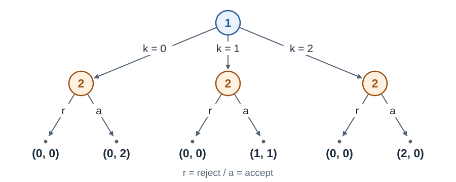
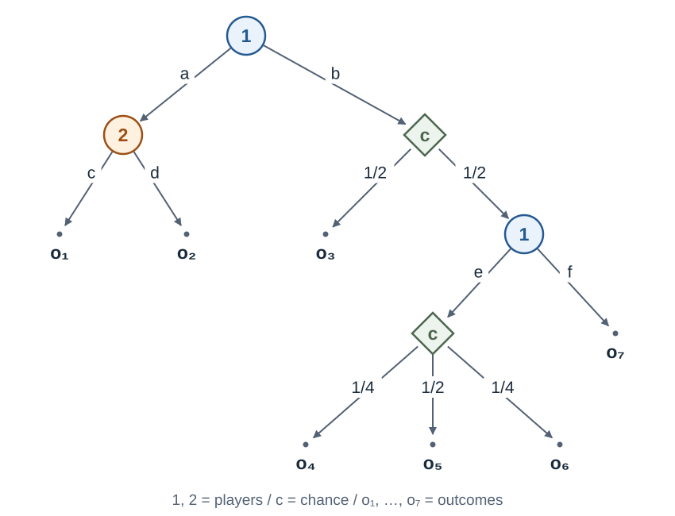
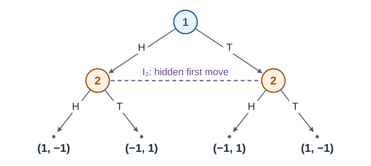
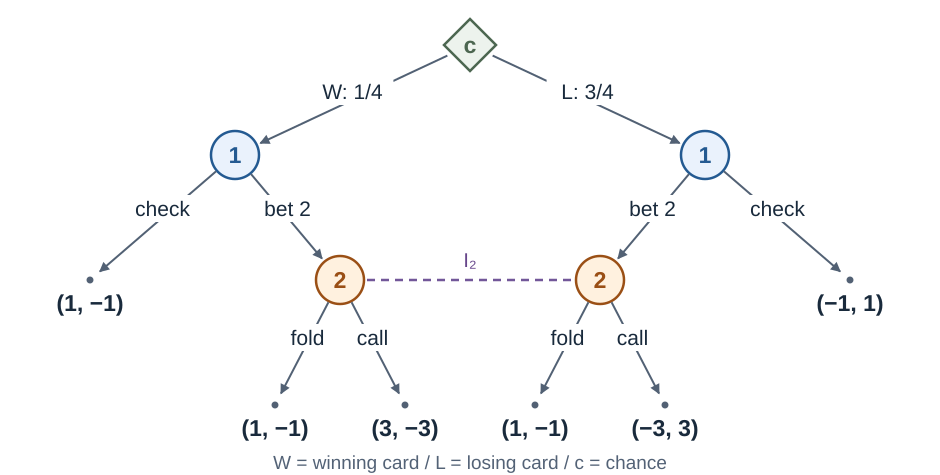
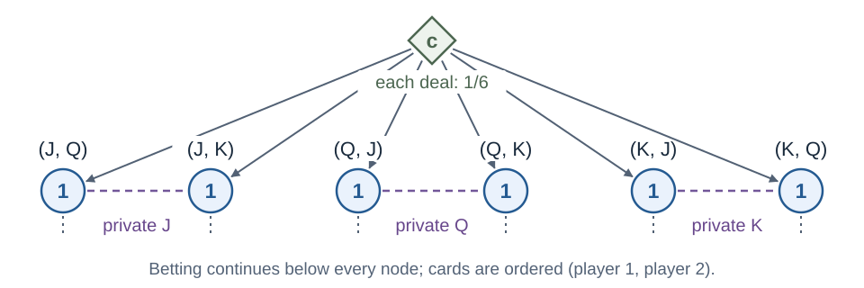
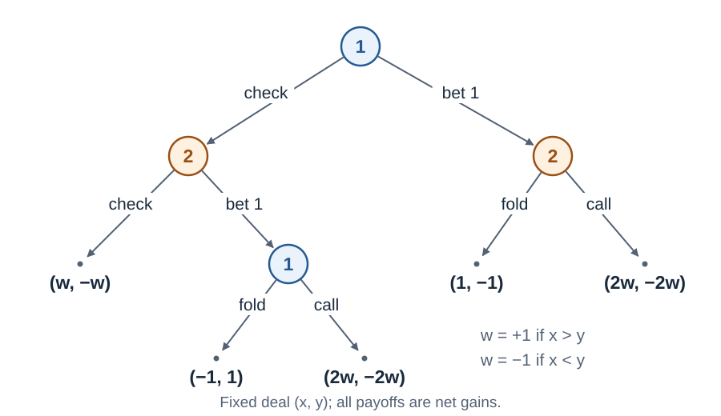
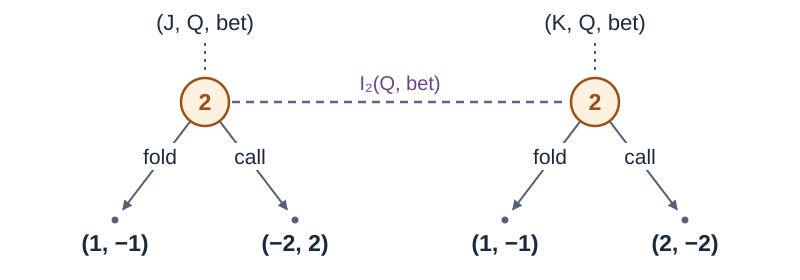
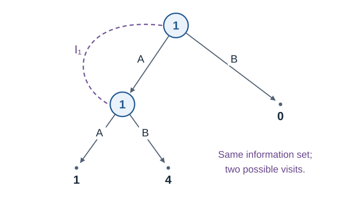

A normal-form game lists complete strategies and their payoffs. An
**extensive-form game** also describes who moves when, what the players have
observed, and which random events are involved in the game. These distinctions matter even
in a game with only a handful of actions: responding to an observed move
might lead to a different decision than responding to a move that remains hidden.

In this lecture we solve equilibria only in the perfect-information part. The remaining
parts develop the models and strategy representations needed for
the next lecture on solving extensive-form games. 

## Perfect information {#sec-efg-perfect-information}

### Trees, histories, and contingent plans

A **history** is a sequence of actions of players from the root of a game tree to a
node. The empty history $\varnothing$ is the root; $ha$ denotes history
$h$ followed by action $a$. A **terminal history** ends the game and carries
a payoff vector; in the game tree, it corresponds to a *leaf* of the tree. At every other node, the tree specifies the acting player
and the available actions. In a extensive-form game of **perfect information**, a player
knows the entire preceding history whenever it is their turn. Examples include chess, Go, checkers, and tic-tac-toe.

::: {.callout-note appearance="minimal" icon="false" title="Example: dividing two coins"}



{#fig-efg-two-coin-bargaining width=100% fig-alt="Player 1 chooses k equal to 0, 1 or 2. At each separate player 2 node, rejection gives (0, 0); acceptance gives respectively (0, 2), (1, 1) or (2, 0)."}

The root corresponds to $\varnothing$; history $(1)$ corresponds to the proposal to keep
one coin; $(1,a)$ is a terminal history with payoff $(1,1)$.

:::

A **pure strategy** specifies an action at every decision node of the
player, including nodes that will not be reached under that strategy.
For the bargaining game,

$$
S_1=\{0,1,2\},\qquad S_2=\{a,r\}^3.
$$

Write player 2's strategy as $s_2=(s_2(0),s_2(1),s_2(2))\in S_2$.
For example, $aar$ accepts the first two proposals and rejects the last. Thus, Player 2 has two available actions at each node but *eight pure
strategies*. Specifying only the response to the proposal that actually
occurs does not specify a complete strategy.

The **induced normal form** of this extensive-form game has these complete plans as its strategies.
For each profile, follow the prescribed actions down the tree and use the
terminal payoff. Here the payoffs are

$$
u^{\mathrm{NF}}(k,s_2)=
\begin{cases}
(k,2-k),&s_2(k)=a,\\
(0,0),&s_2(k)=r.
\end{cases}
$$

This gives a $3\times8$ normal-form game. The same construction was used
for the Alice--Bob game in @sec-dynamic-games.

### Nash equilibrium and non-credible threats

A **Nash equilibrium** of the extensive-form game is defined as a Nash equilibrium
of its induced normal form.

For example, consider the profile $(0,arr)$ in the game above. Player 1 proposes to keep nothing and
player 2 accepts, so the payoffs are $(0,2)$. If player 1 changes the proposal to
$1$ or $2$, player 2's fixed plan rejects it, still leaving player 1
with $0$. Player 2 already receives the largest available payoff at
the reached node. Thus neither player has a profitable deviation, which means that
$(0,arr)$ is a Nash equilibrium.

However, after proposal $1$, player 2's plan rejects a coin. If that
node were reached, accepting would give $1$ instead of $0$.
The instruction is called a **non-credible threat**. This example shows that Nash equilibrium alone does not require a best response at a node that the equilibrium never
reaches.

::: {.callout-note appearance="minimal" icon="false" title="Definition"}

In a perfect-information game, a **subgame** consists of a node and all
its descendants, with the inherited players, actions, and payoffs. A strategy profile is a **subgame-perfect equilibrium** (SPE) if its
restriction to every subgame is a Nash equilibrium.

:::

Subgame perfection also tests behavior away
from the realized path. It is clear that every SPE is a Nash equilibrium. In the example, the profile $(0,arr)$ fails the stronger requirement in the subgame
following proposal $1$, so it is a Nash equilibrium that is not an SPE. 

### Backward induction

**Backward induction** chooses optimal actions from the leaves of the tree
toward the root. Keep a continuation payoff vector at each node:

1. At a terminal node, use its payoff vector.
2. At a node of player $i$, choose a successor whose continuation
   payoff is largest for player $i$. Record that action and pass its
   *whole payoff vector* to the parent.
3. Continue until the root is reached. Retain the choices at every
   decision node, including those outside the resulting play path.

In the bargaining game, player 2 accepts proposals $0$ and $1$, since
$2>0$ and $1>0$. At proposal $2$, acceptance and rejection both give
player 2 zero. Choosing rejection there gives the plan $aar$; player 1
then chooses $1$, obtaining $1$ rather than $0$. This yields the SPE
$(1,aar)$. Choosing acceptance at the tie instead gives $aaa$, and
player 1 chooses $2$, yielding the SPE $(2,aaa)$.

::: {.callout-important appearance="minimal" icon="false" title="Proposition"}

Every extensive-form game with perfect information has a SPE. 

:::

*Proof idea.* At the last decision nodes, choose a best action.
Inductively, suppose the continuation profiles already form equilibria
in their subgames. No player can improve within those continuations,
and the player moving at the current node chooses a best continuation.
The resulting profile is therefore an equilibrium in this larger
subgame. Repeat to the root. $\square$

For a fixed number of players, one traversal takes time linear in the size of the *explicit tree*, which can be enormously large. When several actions give the moving player the same maximal continuation payoff, different tie-breaking choices may produce different subgame-perfect equilibria. For two-player zero-sum games, maximizing the moving player’s payoff is the familiar alternating maximization and minimization of minimax.

Although full-tree backward induction is infeasible for large board games, search and evaluation can achieve superhuman play: *Deep Blue* defeated Kasparov in chess (1997) [@campbell2002], *AlphaGo Zero* mastered Go through self-play (2017) [@silver2017zero], and *AlphaZero* outperformed leading programs in chess, shogi, and Go (2018) [@silver2018alphazero]. Superhuman performance does not imply a mathematical solution. By contrast, checkers was *weakly solved* in 2007: the initial position is provably a draw under optimal play [@schaeffer2007].

### Chance nodes {#sec-efg-chance}

A **chance node** represents a random event, such as a die roll or a
card deal. At a history $h$ where chance moves, let $A(h)$ be the set
of possible chance outcomes (or, equivalently, actions). Each action $a\in A(h)$ occurs with a
prescribed probability $\pi_c(a\mid h)$, where

$$
\pi_c(a\mid h)\geq 0,\qquad
\sum_{a\in A(h)}\pi_c(a\mid h)=1.
$$

Chance has no preferences and does not choose a strategy. Its
probabilities are part of the rules of the game and are known to
the players. *Chance is compatible with perfect information if
each player knows all preceding player actions and chance outcomes
whenever it is their turn to act*. For example, publicly observed
dice rolls in backgammon introduce randomness without hiding the preceding
history.

Even a pure strategy profile $\mathbf s=(s_1,\ldots,s_n)$ can therefore
lead to several terminal histories. Let $p_{\mathbf s}(z)$ be the probability
of reaching terminal history $z$ under $\mathbf s$. To compute it, follow
the path from the root to $z$. At a player node, the prescribed
action has probability $1$ and every other action has probability
$0$; at a chance node, use the probability on the corresponding
edge. *Multiply these probabilities along the path.* The chance
probabilities are conditional on reaching their respective nodes, and
no independence assumption is needed.

Let $Z$ be the set of terminal histories and $u_i(z)$ player $i$'s
utility at terminal history $z$. The utility of the strategy profile
in the induced normal form is the **expected utility**:

$$
u_i^{\mathrm{NF}}(\mathbf s)=\sum_{z\in Z}p_{\mathbf s}(z)u_i(z).
$$

In all our game diagrams, diamonds labelled $c$ denote chance nodes.

::: {.callout-note appearance="minimal" icon="false" title="Example: a game with perfect information and chance moves"}



{#fig-efg-chance-moves width=90% fig-alt="Player 1 chooses a or b. After a, player 2 chooses c for (1, 3) or d for (4, 1). After b, chance gives (2, 2) with probability one half or a further player 1 decision with probability one half. Player 1 chooses e or f. Action f gives (3, 3); e leads to (0, 4), (4, 2), (8, 0) with probabilities one quarter, one half, one quarter."}

Suppose player 1 chooses $s_1=(b,e)$ and player 2 chooses $s_2=c$.
Player 2's action is specified even though their node is not reached.
The terminal payoff pairs $(2,2)$, $(0,4)$, $(4,2)$, and $(8,0)$ occur
with probabilities $1/2$, $1/8$, $1/4$, and $1/8$, respectively;
the other leaves have probability zero. Thus the expected payoff vector is

$$
u^{\mathrm{NF}}((b,e),c)
=\frac12(2,2)+\frac18(0,4)+\frac14(4,2)+\frac18(8,0)
=(3,2).
$$

:::

Backward induction can also be applied to games with chance moves. At a chance node, take the
probability-weighted average of the successor payoff vectors. At a
player node, choose the successor that maximizes that player's own
payoff and carry its whole payoff vector backward. In this example:

1. The lower chance node has expected payoffs
   $\frac14(0,4)+\frac12(4,2)+\frac14(8,0)=(4,2)$.
   Player 1 therefore chooses $e$ over $f$, since $4>3$.
2. The upper chance node then has expected payoffs
   $\frac12(2,2)+\frac12(4,2)=(3,2)$.
   On the other branch, player 2 chooses $c$ over $d$, since $3>1$,
   giving $(1,3)$.
3. At the root, player 1 chooses $b$ over $a$, since $3>1$.
   The resulting subgame-perfect equilibrium is $((b,e),c)$,
   with expected payoffs $(3,2)$.

## Imperfect information {#sec-efg-information}

The game tree records everything that has happened. A player may see
only part of it. In poker, the actual history includes both players'
cards, while a player sees their own card and the public betting
history. Two different histories can therefore look identical to the
player who must act.

### Histories and what a player observes

::: {.callout-note appearance="minimal" icon="false" title="Definition"}

An **information set** $I$ of player $i$ is a set of histories that player $i$ cannot distinguish when it is their turn. Let $\mathcal I_i$ be the collection of all information sets of player $i$.

:::

We will further assume that:

- The collection $\mathcal I_i$ is a *partition* of the histories of player $i$.
- For every information set $I\in \mathcal I_i$, any history $h\in I$ has the same set of available actions, denoted $A(I)$.
- A pure strategy of player $i$ prescribes the same action at every history in $I\in \mathcal I_i$.

Perfect information means all information sets are
singletons. A game has **imperfect information** if some information
set contains more than one history. In our diagrams of game trees, a dashed link joins nodes in one information set. 

### Extensive-form game with imperfect information

The definition of an **extensive-form game with imperfect information** requires specifying the game tree, information partitions, and payoffs [@shoham2008, Chapter 5]. We use the following notation throughout the rest of the chapter.

| Component | Meaning |
|:--|:--|
| $N=\{1,\ldots,n\}$ | Players |
| $c$ | Chance |
| $H$ | Set of histories, containing $\varnothing$ and every prefix of each history |
| $Z\subseteq H$ | Terminal histories |
| $P\colon H\setminus Z\to N\cup\{c\}$ | Acting player or chance $c$ |
| $A(h)=\{a:ha\in H\}$ | Available actions at a nonterminal history |
| $\pi_c(\cdot\mid h)\in\Delta(A(h))$ | Commonly known chance probabilities |
| $u_i:Z\to\mathbb R$ | Player $i$'s utility function |

 In contrast with chance moves in perfect-information games, players may know the probabilities of chance outcomes *without observing which outcome occurred*. For example, a player may know how cards are shuffled and dealt without seeing an opponent’s card. Such hidden outcomes give rise to imperfect information. 
 

### Encoding a normal-form game as a tree {#sec-efg-normal-form-encoding}

Start with the matching-pennies:





{#fig-efg-matching-pennies width=90% fig-alt="Player 1 chooses H or T. The two subsequent player 2 nodes are in one information set, with actions H and T at both. Matching choices give payoffs (1, -1), and different choices give (-1, 1)."}

Player 2 has one information set and two pure strategies, $H$ and $T$.
The instruction "choose $T$ after $H$ and $H$ after $T$" is
unavailable: it would condition on an unobserved choice. The
induced normal form is exactly the matrix above. 

If we remove the dashed link and make the game into a perfect-information game, player 2 observes the first move and
has four pure strategies, $HH,HT,TH,TT$.
The distinction lies in observation, even though the actions and
terminal payoffs have stayed the same.

More generally, encode any finite normal-form game by letting the
players choose in a fixed order, while hiding all earlier choices
from every later player. Each player then has one information set,
and each terminal history receives the payoff of the corresponding
normal-form profile. This representation preserves the strategies
and payoffs of the original simultaneous game.

### Subgames must respect information

With imperfect information, a subtree is a **subgame** only if it
starts at a singleton information set (or a chance node), includes
all descendants, and *does not cut any information set*: whenever
it contains one node of an information set, it contains all its nodes.

For example, neither player 2 node in hidden-move matching pennies
can start a subgame. Starting at just one would reveal the first
move, changing the information available to player 2. Subgame
perfection remains a well-defined concept, but it cannot justify
solving these two nodes separately. We defer equilibrium analysis
for imperfect-information games to the next lecture.

## Poker {#sec-efg-poker}

### A basic poker endgame



{#fig-efg-poker-endgame width=100% fig-alt="Chance deals W with probability one quarter or L with probability three quarters. Player 1 checks or bets at separate nodes. Checks pay (1, -1) for W and (-1, 1) for L. After a bet, player 2's nodes are linked: folding pays (1, -1), while calling pays (3, -3) for W and (-3, 3) for L."}

Player 1 has two singleton information sets: one for $W$ and one for
$L$. Player 2 has a single information set after a bet. The four pure strategies for player 1 prescribe
check or bet separately for each card. Player 2's two pure strategies are
fold and call.

Betting with $L$ is a *bluff*: the card would lose at showdown, but
a fold still produces a positive payoff. 

### Kuhn poker {#sec-efg-kuhn-poker}

Kuhn introduced this game in *A Simplified Two-Person Poker*
[@kuhn1950poker]. Kuhn poker adds a private card for each player and a second
opportunity for player 1 to act. It is small enough to describe
completely while retaining bluffing, hidden information, and
decisions that depend on earlier betting.



Let $x$ be player 1's card and $y$ player 2's. We represent the deal as one chance outcome

$$
(x,y)\in\{(J,Q),(J,K),(Q,J),(Q,K),(K,J),(K,Q)\},
$$

where each $(x,y)$ has the probability $1/6$. 

{#fig-efg-kuhn-poker-deal width=100% fig-alt="Chance selects one of (J,Q), (J,K), (Q,J), (Q,K), (K,J), (K,Q), each with probability one sixth. Player 1's six opening nodes are grouped into three information sets according to the first card."}

Write $c$ for check, $b$ for bet, $f$ for fold, and $\ell$ for call.
For every deal there are exactly five terminal betting sequences:

| Betting sequence | Outcome | Player 1's net gain |
|:--|:--|:--|
| $cc$ | Showdown without a bet | $w$ |
| $bf$ | Player 2 folds | $+1$ |
| $b\ell$ | Player 2 calls | $2w$ |
| $cbf$ | Player 1 folds | $-1$ |
| $cb\ell$ | Player 1 calls | $2w$ |

Here $w=1$ if $x>y$ and $w=-1$ if $x<y$; player 2 receives the
negative of player 1's payoff. 

@fig-efg-kuhn-poker-betting is the betting tree for *one fixed deal*. The full game contains six copies of this continuation, connected by
information sets across deals. There are $6\cdot5=30$ terminal
histories.  For the complete game tree, see [@schmid2025efg].

{#fig-efg-kuhn-poker-betting width=100% fig-alt="Player 1 checks or bets. After a check, player 2 checks for payoff (w, -w), or bets; player 1 then folds for (-1, 1) or calls for (2w, -2w). After an opening bet, player 2 folds for (1, -1) or calls for (2w, -2w)."}

### Information sets in Kuhn poker

Each information set is identified by the acting player's *own card
and the public betting history*. The other card remains hidden.
For example, player 1 holding $Q$ initially cannot distinguish the
deals $(Q,J)$ and $(Q,K)$. After checking and facing a bet, those
same two deals again form an information set, but a different one:
the player remembers having checked and having seen a bet.

The full information structure can be specified as follows:

| Player | Information set | Histories | Actions |
|:--|:--|:--|:--|
| 1 | $I_1(x,\varnothing)$ | $\{(x,y)\mid y\ne x\}$ | $c,b$ |
| 1 | $I_1(x,cb)$ | $\{(x,y,c,b)\mid y\ne x\}$ | $f,\ell$ |
| 2 | $I_2(y,c)$ | $\{(x,y,c)\mid x\ne y\}$ | $c,b$ |
| 2 | $I_2(y,b)$ | $\{(x,y,b)\mid x\ne y\}$ | $f,\ell$ |

Each row represents three information sets, one for each possible
own card. Thus each player has six information sets, with two
histories and two actions in each.

In the last diagram, player 2 holds $Q$ and faces a bet. Against $J$,
calling wins two chips; against $K$, calling loses two chips. The
player cannot choose a different response at those two nodes.

{#fig-efg-kuhn-poker-information width=90% fig-alt="A partial tree shows histories (J,Q,bet) and (K,Q,bet) joined in player 2's information set. A fold gives (1, -1) at either node. A call gives (-2, 2) against J and (2, -2) against K."}

## Pure, mixed, and behavioral strategies {#sec-efg-strategies}

### Pure and mixed strategies

For extensive-form games with imperfect information, a player is allowed to select only 
one action at each information set. Thus, the set of pure strategies of player $i$ becomes

$$
S_i=\bigtimes_{I\in\mathcal I_i}A(I).
$$

Specifically, a **pure strategy** $s_i\in S_i$ selects a single action $s_i(I)\in A(I)$ for every information set $I\in\mathcal I_i$. A **mixed strategy** is a probability distribution $p_i\in\Delta(S_i)$ over player $i$’s pure strategies. Before play begins, one pure strategy is sampled according to $p_i$, and the player then follows this complete plan throughout the game.

For Kuhn poker, each player has $2^6=64$ pure strategies. For player 1,
a strategy specifies an opening decision for each of $J,Q,K$ and a
response to check--bet for each card. Even if it always bets with
$K$, it must prescribe what to do after checking with $K$ and
facing a bet. The full induced normal form would be $64\times64$ matrix, where each cell averages over the six possible deals.

### Behavioral strategies

Under a mixed strategy, a player randomly selects a pure strategy before play begins and follows its prescribed actions throughout the game. We now consider a natural alternative: randomizing over the available actions at each information set during play.

::: {.callout-note appearance="minimal" icon="false" title="Definition"}

A **behavioral strategy** $\beta_i$ assigns a probability distribution $\beta_i(\cdot\mid I)\in\Delta(A(I))$ to every information set $I\in\mathcal I_i$.

:::

When information set $I$ is reached, player $i$ draws an action from
that distribution, independently of the random draws used at other
decisions. The same distribution applies at every history in $I$.

In Kuhn poker, a behavioral strategy for player 1 consists of six
probabilities: the probability of betting with each card at the
opening, and the probability of calling with each card after
check--bet. One probability determines the other action's
probability at each two-action information set. For example, prescribing a call probability of $1/3$ at
$I_2(Q,b)$ means calling with probability $1/3$ both at $(J,Q,b)$
and at $(K,Q,b)$.

In the table we summarize the properties of the three types of strategies discussed above.

| Strategy | What is randomized? | Size for one player of  Kuhn-poker|
|:--|:--|:--|
| *Pure* | Nothing | 6 actions |
| *Mixed* | A pure strategy before play | 63 free probabilities |
| *Behavioral* | An action when an information set is reached | 6 free probabilities |

### Evaluating a behavioral profile {#sec-efg-evaluation}

Let $I(h)$ denote the information set containing a decision
history $h$. Given a profile of behavioral strategies $\boldsymbol\beta=(\beta_1,\dots,\beta_n)$, define 

$$
q_{\boldsymbol\beta}(a\mid h)=
\begin{cases}
\pi_c(a\mid h),&P(h)=c,\\
\beta_{P(h)}(a\mid I(h)),&P(h)\in N,
\end{cases}
$$

for every $a\in A(h)$. The probability of reaching a history is the product of the
probabilities along its path. For a terminal history $z$, this becomes

$$
\mathrm{Pr}_{\boldsymbol\beta}(z)
=\prod_{ha\preceq z}q_{\boldsymbol\beta}(a\mid h),
$$
where $ha\preceq z$ means that $ha$ is a prefix of $z$. The **expected utility** of player $i$ under a behavioral profile $\boldsymbol \beta$ is
$$
U_i(\boldsymbol\beta)
=\sum_{z\in Z}\mathrm{Pr}_{\boldsymbol\beta}(z)\cdot u_i(z).
$$

For example, suppose player 1 bets with $J$ with probability $1/4$
and player 2 calls with $Q$ after an opening bet with probability
$1/3$. Then

$$
\Pr(J,Q,b,\ell)=\frac16\cdot\frac14\cdot\frac13=\frac1{72}.
$$

At that terminal history, player 1 loses two chips, so its
contribution to $U_1$ is $-2/72=-1/36$. Other terminal histories
provide the remaining terms. 

## Perfect recall and Kuhn's theorem {#sec-efg-perfect-recall}

We have introduced two ways to randomize in extensive-form games: selecting a pure strategy randomly before play begins (mixed strategy), or randomizing over actions during play (behavioral strategy). Each approach induces a distribution over terminal histories and hence an expected utility for every player. Can every distribution induced by one approach also be obtained using the other? In general, the answer is no. Perfect recall is the key condition that guarantees their equivalence.

### Remembering one's own decisions

Imperfect information means that a player cannot distinguish some histories when choosing an action. The concept of imperfect recall means that a player has forgotten something they previously knew or an action they previously took.

::: {.callout-note appearance="minimal" icon="false" title="Definition"}

For a history $h$ at which player $i$ acts, we define the **recall sequence**  

$$
R_i(h)=((I_i^1,a_i^1),\ldots,(I_i^k,a_i^k))
$$

as the tuple of player $i$'s earlier information sets and
the actions along the path to $h$.
Player $i$ has **perfect recall** if, for every information set $I\in\mathcal I_i$,

$$
h,h'\in I\quad\Longrightarrow\quad
R_i(h)=R_i(h').
$$

The game has perfect recall if every player does, and has **imperfect recall** otherwise.

:::

The condition requires the same sequence of *the player's own*
past information sets and actions. It does not require the complete
histories, opponents' hidden actions, or unobserved chance outcomes
to coincide.

Kuhn poker has perfect recall: a player retains their card and the
betting history, including their own choices. Holding $Q$ while
being unsure whether the opponent has $J$ or $K$ is compatible
with perfect recall. Merging decisions with different remembered
own cards or different earlier own actions would violate it.
Every perfect-information game also has perfect recall.

### What the equivalence theorem says {#sec-efg-kuhn-theorem}

We say that a behavioral strategy and a mixed strategy of player $i$ are **realization-equivalent** if, for every fixed strategy profile of the other players, they induce the same probability of every terminal history.

::: {.callout-important appearance="minimal" icon="false" title="Theorem [@kuhn1953]"}

In an extensive-form game with imperfect information and perfect recall, every mixed
strategy of a player has a realization-equivalent behavioral
strategy, and every behavioral strategy has a realization-equivalent
mixed strategy.

:::

In particular, all players' expected utilities are preserved. Kuhn's theorem justifies representing strategies locally without
losing the outcomes available from mixed strategies. With two actions
at each of $m$ information sets, a mixed strategy has $2^m-1$
free probabilities, whereas a behavioral strategy has $m$.
This reduction is essential for computation.

*Why perfect recall helps.* Starting with a behavioral strategy,
independently pre-sample an action for every information set. This
produces a distribution over pure strategies with the same path
probabilities. In the other direction, start with a mixed strategy and,
at each information set, *condition* its next prescribed action on
the player's own remembered earlier actions. Perfect recall makes
that remembered sequence identical at every node in the information
set, so the conditional prescription is well defined. If the
conditioning event has probability zero under the player's own
strategy, the local distribution can be chosen arbitrarily.

::: {.callout-note appearance="minimal" icon="false" title="Example"}

Fix one private card in Kuhn poker. Suppose player 1 mixes equally
between the pure strategies

$$
(\text{check},\text{fold after check--bet})
\quad\text{and}\quad
(\text{bet},\text{call after check--bet}),
$$

with identical instructions for the other cards. The equivalent
behavioral strategy checks with probability $1/2$ initially.
After check--bet, it *folds with probability one*: only the first
sampled strategy can produce the player's earlier check.

Using the unconditional $1/2$ call probability at the later decision
would be wrong. Against an opponent who bets after a check, it
would introduce a check--bet--call path with positive probability,
although neither of the sampled strategies produces that path.

:::

### Why the recall assumption is necessary



{#fig-efg-forgotten-visit width=85% fig-alt="One player acts at two nodes in the same information set. B at the root gives 0, while A continues. At the second node A gives 1 and B gives 4. The player forgets the earlier visit and action."}

At the second node the player has forgotten the first visit and their own action $A$, so perfect
recall fails: two different histories $\varnothing$ and $A$ reaching $I_1$ have different recall sequences, $\varnothing$ and $((I_1,A))$.

There are only two pure strategies: choose $A$ at the information
set, or choose $B$. In particular, any mixed strategy assigns probability zero to history $AB$. On the other hand, a behavioral strategy choosing $A$ with probability $q$ uses an independent draw on *each visit*. It gives terminal probabilities
$1-q$ for $B$, $q^2$ for $AA$, and $q(1-q)$ for $AB$. In particular, the history $AB$ has positive probability for $0<q<1$, which no mixed strategy can achieve.

## Why finding equilibria becomes harder {#sec-efg-computation-barriers}

A Nash equilibrium of an extensive-form game with perfect information is a Nash equilibrium
of its induced normal-form game. For an imperfect-information game with
perfect recall, Kuhn's theorem allows us to express this condition
directly using behavioral strategies.

::: {.callout-note appearance="minimal" icon="false" title="Definition"}

In an imperfect-information game with perfect recall, a behavioral-strategy
profile $\boldsymbol\beta^*=(\beta_1^*,\ldots,\beta_n^*)$ is a **Nash
equilibrium** if

$$
U_i(\beta_i^*,\boldsymbol\beta_{-i}^*)
\geq U_i(\beta_i,\boldsymbol\beta_{-i}^*)
$$

for every player $i$ and every behavioral strategy $\beta_i$ of that
player.

:::

A unilateral deviation may change a player's prescribed behavior at any or all information sets, while the other players' strategies remain fixed. Nash equilibrium is therefore well-defined under imperfect information. However, decisions at nodes in the same information set must use the same action distribution, preventing the independent optimization used in backward induction. Pure-strategy equilibria may also fail to exist, as illustrated by the extensive-form representation of matching pennies in @sec-efg-normal-form-encoding.

These obstacles call for methods that respect information sets.
 The next lecture
develops *sequence form* and *counterfactual regret minimization*.

