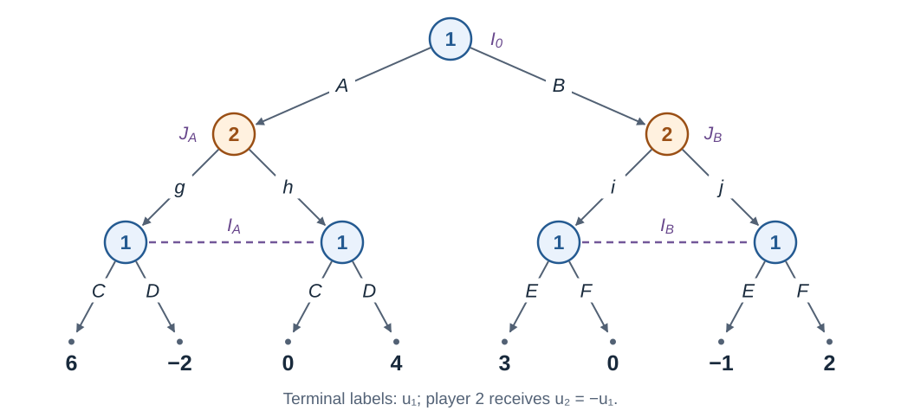

An information set contains histories that a player cannot
distinguish. Choosing a best action separately at each unobserved history
would give the player information that the rules do not provide.
Equilibrium computation must respect these constraints throughout the game.

We develop two approaches: 

1. *Sequence form* [@vonstengel1996] represents strategies by
linear constraints and thus leads to linear programming formulation.
1. *Counterfactual regret minimization* (CFR) [@zinkevich2007cfr] learns a strategy through  updates at
information sets. 

Both exploit the game tree without listing all pure strategies. The first half of lecture develops the representation and an exact optimization formulation of the sequence form. The second part explains the learning principle behind CFR and how it supports large-scale game solving.

In this lecture, all extensive-form games are **two-player, zero-sum, and have perfect
recall**. We write $u=u_1=-u_2$, and use the histories, information sets,
chance probabilities, and behavioral strategies $\boldsymbol\beta$
from @sec-efg-information and @sec-efg-strategies. Perfect recall connects
these behavioral strategies to mixed strategies through Kuhn's theorem
(@sec-efg-perfect-recall).

## Sequence form {#sec-solving-sequence-form}
A pure strategy specifies an action at every information set, including information sets that will never be reached. The number of pure strategies of player $i$ is
$$|S_i|=\prod_{I\in\mathcal I_i}|A(I)|.$$
Most prescriptions in a a pure strategy $s_i\in S_i$ will not be used
in one play of the game. Consequently, a normal-form payoff table can
repeat the same terminal payoff many times.

::: {.callout-note appearance="minimal" icon="false" title="Example"}



{#fig-solving-sequence-example width=100% fig-alt="Player 1 chooses A or B. Player 2 observes this and chooses g or h after A, and i or j after B. Player 1 does not observe that response: the two A continuation nodes form information set I A with actions C,D, and the two B nodes form I B with actions E,F. The eight terminal payoffs to player 1, from left to right, are 6,-2,0,4,3,0,-1,2."}

Player 1 has eight pure strategies: $ACE$, $ACF$, $ADE$, $ADF$, $BCE$, $BCF$, $BDE$, $BDF$.
Player 2 has four: $gi,gj,hi,hj$. For example, $ACE$ and $ACF$ give
the same outcome against every opponent strategy, since choosing $A$
makes the prescription after $B$ irrelevant. The game has eight leaves,
but its full normal-form table has $8\cdot4=32$ entries.

:::

### Sequences 

::: {.callout-note appearance="minimal" icon="false" title="Definition"}

A **sequence** of player $i$ records information sets and
actions of player $i$ along a path from the root. Let $\Sigma_i$ contain the empty sequence $\varnothing$ and
every sequence ending immediately after one of player $i$'s actions.

:::

By perfect recall, all histories in $I\in\mathcal I_i$ have the same
preceding sequence of player $i$, denoted $\sigma_i(I)$. Write
$\sigma_i(I)a$ for its extension by action $a$ at $I$.

Each action in a sequence is recorded together with the information set
at which it is taken. Thus, action $\text{call}$ at information set $I$ and $\text{call}$
at a different information set $J$ are distinct choices, represented by
the pairs $(I,\text{call})$ and $(J,\text{call})$.
When labels are unambiguous, we abbreviate a sequence to its action labels.
In @fig-solving-sequence-example,

$$
\Sigma_1=\{\varnothing,A,B,AC,AD,BE,BF\},\qquad
\Sigma_2=\{\varnothing,g,h,i,j\}.
$$

The history $AgC$ contains actions of both players. It contains sequences $AC$ for player 1 and $g$ for player 2. In contrast, $ACE$ is a
pure strategy, not a sequence: no path contains both $C$ and $E$.

Each action in an information-set creates one sequence, so

$$
|\Sigma_i|=1+\sum_{I\in\mathcal I_i}|A(I)|.
$$

Thus, the number of sequences is at most the number of nodes in the explicitly represented game tree [@vonstengel1996].

### Realization plans 

::: {.callout-note appearance="minimal" icon="false" title="Definition"}

A **realization plan** of player $i$ is a vector
$r_i=(r_i(\sigma))_{\sigma\in\Sigma_i}$ of nonnegative numbers satisfying $r_i(\varnothing)=1$ and the following constraints:
$$
\sum_{a\in A(I)}r_i(\sigma_i(I)a)=r_i(\sigma_i(I))
\quad\text{for every }I\in\mathcal I_i.
$$ 

Each component $r_i(\sigma)$ is called the **realization weight** of
sequence $\sigma$.

:::

At each information set, the constraint distributes the weight of
the player's preceding sequence among its possible action extensions.
For our running example, in addition to $r_1(\varnothing)=r_2(\varnothing)=1$,
the constraints are

$$
\begin{aligned}
r_1(A)+r_1(B)&=1, & r_2(g)+r_2(h)&=1,\\
r_1(AC)+r_1(AD)&=r_1(A), & r_2(i)+r_2(j)&=1,\\
r_1(BE)+r_1(BF)&=r_1(B).
\end{aligned}
$$

Every realization plan represents a given strategy. To see this, start with a
behavioral strategy $\beta_i$ and define $r_i$ recursively:

$$
r_i(\varnothing)=1,\qquad
r_i(\sigma_i(I)a)=r_i(\sigma_i(I))\cdot \beta_i(a\mid I).
$$

These weights satisfy the constraints because
$\sum_{a\in A(I)}\beta_i(a\mid I)=1$, so $r_i$ form a realization plan.
The weight $r_i(\sigma)$ records only player $i$'s contribution to reaching a history;
its actual reach probability also depends on opponents and chance.

Conversely, given a realization plan $r_i$, recover a behavioral strategy $\beta_i$ by
setting

$$
\beta_i(a\mid I)=
\frac{r_i(\sigma_i(I)a)}{r_i(\sigma_i(I))}
\quad\text{when }r_i(\sigma_i(I))>0.
$$ {#eq-real-beh}

When the denominator is zero, all outgoing
weights are zero, and we may choose any probability distribution over
$A(I)$. The player's earlier choices already prevent reaching $I$, so
this choice does not affect the realization plan.

For example, if $r_1(A)=3/5$ and $r_1(AC)=1/5$, then
$$\beta_1(C\mid I_A)=\frac{1/5}{3/5}=\frac 13.$$
If $\beta_2(g\mid J_A)=1/4$, the actual
probability of terminal history $AgC$ is

$$
\beta_1(A)\cdot \beta_2(g\mid J_A) \cdot \beta_1(C\mid I_A)=\frac 35\cdot \frac 14\cdot \frac 13= \frac{1}{20}.
$$

### A sparse payoff matrix

Let $\sigma_i(z)$ be player $i$'s complete sequence along terminal history
$z\in Z$, which corresponds to a leaf of the game tree. Let $\pi_c(z)$ be the product of chance probabilities along that
history, with value $1$ if there are no chance moves. For all sequences $s_1\in \Sigma_1$ and $s_2\in \Sigma_2$, define

$$
G_{s_1,s_2}
=\sum_{\substack{z\in Z \\\sigma_1(z)=s_1\\ \sigma_2(z)=s_2}}
\pi_c(z)\cdot u(z).
$$

If $s_1$ and $s_2$ has no corresponding leaf, we set $G_{s_1,s_2}=0$.
This defines a matrix $G$ indexed by $\Sigma_1$ and $\Sigma_2$. 

Let $\beta_1$ and $\beta_2$ be behavioral strategies inducing the realization
plans $r_1$ and $r_2$. The probability of reaching a terminal history $z$
is 

$$
\mathrm{Pr}_{\boldsymbol\beta}(z)
=\pi_c(z)\cdot r_1(\sigma_1(z))\cdot r_2(\sigma_2(z)).
$$

Consequently, the expected utility $U(\beta_1,\beta_2)$ of player 1 depends on the
behavioral strategies only through their realization plans. Any behavioral
strategies inducing the same pair of realization plans therefore yield
the same expected utility. We may thus write this utility as a function
of the realization plans:

$$
U(r_1,r_2)
:=U(\beta_1,\beta_2)
=\sum_{z\in Z}\mathrm{Pr}_{\boldsymbol\beta}(z)\cdot u(z)
=r_1^{\mathsf T}G r_2.
$$ {#eq-solving-bilinear}

For our running example, the matrix $G$ is



The empty and intermediate sequences still matter in the constraint equations,
even when their matrix rows or columns are zero.

### Linear programming formulation

For each player $i$, collect the realization plan  constraints into a matrix equation $E_i r_i=e_i$. We construct the matrix $E_i\in\mathbb R^{(1+|\mathcal I_i|)\times|\Sigma_i|}$ and vector $e_i\in\mathbb R^{1+|\mathcal I_i|}$ as follows. In the normalization row, put

$$
(E_i)_{0,\sigma}=
\begin{cases}
1,&\sigma=\varnothing,\\
0,&\text{otherwise}.
\end{cases}
$$

In the row for information set $I$, define:

$$
(E_i)_{I,\sigma}=
\begin{cases}
-1,&\sigma=\sigma_i(I),\\
1,&\sigma=\sigma_i(I)a\text{ for some }a\in A(I),\\
0,&\text{otherwise}.
\end{cases}
$$

Finally, set $(e_i)_0=1$ and $(e_i)_I=0$ for every information set $I$. Nonnegativity is imposed separately: $r_i\ge0$.

 For example, the row
for player 1's information set $I_A$ in the running game example has coefficient
$-1$ in column $A$, coefficients $+1$ in columns $AC,AD$, and zeros
elsewhere. Its constraint is $-r_1(A)+r_1(AC)+r_1(AD)=0$.

To simplify notation for two players, write

$$
x=r_1,\quad E=E_1,\quad e=e_1,
\qquad
y=r_2,\quad F=E_2,\quad f=e_2.
$$

The sets of realization plans are then

$$
X=\{x\ge0:Ex=e\},\qquad Y=\{y\ge0:Fy=f\}.
$$
 Since $x^{\mathsf T}Gy$ is player 1's
expected payoff and the game is zero-sum, the problem is to solve 

$$
\max_{x\in X}\min_{y\in Y}x^{\mathsf T}Gy.
$$

Fix $x\in X$. Player 2's problem is then the linear program

$$
\min_y\;(G^{\mathsf T}x)^{\mathsf T}y
\qquad\text{subject to}\qquad Fy=f, \quad y\ge0.
$$

Introduce one dual variable for each equality constraint in $Fy=f$
and collect these variables into a vector $v$. 
The dual problem is

$$
\max_v\;f^{\mathsf T}v
\qquad\text{subject to}\qquad
F^{\mathsf T}v\le G^{\mathsf T}x, \quad v\in \mathbb{R}^{1+|\mathcal I_2|}.
$$

The problem is feasible and has a finite optimal value,
so strong LP duality guarantees that the two problems above have the same optimal value. We can therefore replace the inner minimization over $y$ by
the maximization over $v$. Maximizing also over $x\in X$ gives
a single linear program in $(x,v)$.

Applying the same argument with the players' roles reversed gives
the companion minimization problem. Thus, we obtain the following pair
of sequence-form LPs [@vonstengel1996]:

Player 1 solves

$$
\begin{aligned}
\underset{x,v}{\text{maximize}}\quad &f^{\mathsf T}v\\
\text{subject to}\quad &Ex=e,\quad x\ge0, \quad v\in \mathbb{R}^{1+|\mathcal I_2|},\\
&F^{\mathsf T}v\le G^{\mathsf T}x.
\end{aligned}
$$

Player 2 solves

$$
\begin{aligned}
\underset{y,w}{\text{minimize}}\quad &e^{\mathsf T}w\\
\text{subject to}\quad &Fy=f,\quad y\ge0, \quad w \in \mathbb{R}^{1+|\mathcal I_1|},\\
&E^{\mathsf T}w\ge Gy.
\end{aligned}
$$

Strong LP duality gives a common optimal value and a pair of equilibrium realization
plans. The equilibrium behavioral strategies are then recovered from realization plans using ([-@eq-real-beh]).

### A worked sequence-form LP {#sec-solving-sequence-example}

We now construct the two LPs for our running example. Order the realization-plan coordinates as

$$
x=(x_{\varnothing},x_A,x_B,x_{AC},x_{AD},x_{BE},x_{BF}),
\quad
y=(y_{\varnothing},y_g,y_h,y_i,y_j).
$$

These are the row and column orders of the payoff matrix $G$ displayed
above. In particular, $x\in\mathbb R^7$, $y\in\mathbb R^5$, and
$G\in\mathbb R^{7\times5}$.

The realization-plan constraints for player 1 are defined by matrix $E\in\mathbb{R}^{4\times 7}$ and vector $e\in \mathbb R^4$:
$$
E=\begin{pmatrix}
1&0&0&0&0&0&0\\
-1&1&1&0&0&0&0\\
0&-1&0&1&1&0&0\\
0&0&-1&0&0&1&1
\end{pmatrix},
\qquad
e=\begin{pmatrix}1\\0\\0\\0\end{pmatrix}.
$$

Thus $Ex=e$ says

$$
x_{\varnothing}=1,\;
x_A+x_B=x_{\varnothing},\;
x_{AC}+x_{AD}=x_A,\;
x_{BE}+x_{BF}=x_B.
$$

Similarly, for player 2:

$$
F=\begin{pmatrix}
1&0&0&0&0\\
-1&1&1&0&0\\
-1&0&0&1&1
\end{pmatrix},
\qquad
f=\begin{pmatrix}1\\0\\0\end{pmatrix}.
$$

The equations $Fy=f$ are

$$
y_{\varnothing}=1,\qquad
y_g+y_h=y_{\varnothing},\qquad
y_i+y_j=y_{\varnothing}.
$$
 The vector $v$ is

$$
v=(v_0,v_{J_A},v_{J_B})^{\mathsf T}\in\mathbb R^3.
$$
The full LP for player 1 is:

$$
\begin{aligned}
\underset{x,v}{\text{maximize}}\quad &v_0\\
\text{subject to}\quad
&x_{\varnothing}=1,\\
&x_A+x_B=x_{\varnothing},\\
&x_{AC}+x_{AD}=x_A,\qquad x_{BE}+x_{BF}=x_B,\\
&v_0-v_{J_A}-v_{J_B}\le0,\\
&v_{J_A}\le6x_{AC}-2x_{AD},\\
&v_{J_A}\le4x_{AD},\\
&v_{J_B}\le3x_{BE},\\
&v_{J_B}\le-x_{BE}+2x_{BF},\\
&x\ge0,\qquad v\in\mathbb R^3.
\end{aligned}
$$

 The vector $w$ is

$$
w=(w_0,w_{I_0},w_{I_A},w_{I_B})^{\mathsf T}
\in\mathbb R^4,
$$

so the LP for player 2 is:

$$
\begin{aligned}
\underset{y,w}{\text{minimize}}\quad &w_0\\
\text{subject to}\quad
&y_{\varnothing}=1,\\
&y_g+y_h=y_{\varnothing},\qquad y_i+y_j=y_{\varnothing},\\
&w_0-w_{I_0}\ge0,\\
&w_{I_0}-w_{I_A}\ge0,\\
&w_{I_0}-w_{I_B}\ge0,\\
&w_{I_A}\ge6y_g,\\
&w_{I_A}\ge-2y_g+4y_h,\\
&w_{I_B}\ge3y_i-y_j,\\
&w_{I_B}\ge2y_j,\\
&y\ge0,\qquad w\in\mathbb R^4.
\end{aligned}
$$

We will check that the column vectors

$$
\begin{aligned}
x^*&=(1,1,0,\tfrac12,\tfrac12,0,0),
&v^*&=(2,2,0),\\
y^*&=(1,\tfrac13,\tfrac23,\tfrac12,\tfrac12),
&w^*&=(2,2,2,1)
\end{aligned}
$$

are the optimal solutions. For the inequalities,
direct multiplication gives

$$
F^{\mathsf T}v^*
=\begin{pmatrix}0\\2\\2\\0\\0\end{pmatrix}
=G^{\mathsf T}x^*,
\qquad
E^{\mathsf T}w^*
=\begin{pmatrix}0\\0\\1\\2\\2\\1\\1\end{pmatrix}
\ge
Gy^*
=\begin{pmatrix}0\\0\\0\\2\\2\\1\\1\end{pmatrix}.
$$

Both solutions are feasible and their objectives agree:

$$
f^{\mathsf T}v^*=2=e^{\mathsf T}w^*.
$$

Weak duality then certifies that both are optimal, so the value of the game
is $2$. The resulting behavioral strategies given by ([-@eq-real-beh]) are: $\beta_1(A\mid I_0)=1$, $\beta_1(C\mid I_A)=1/2$, $\beta_2(g\mid J_A)=1/3$, and $\beta_2(i\mid J_B)=1/2$. Player 1 may choose any distribution at the
unreached information set $I_B$.

### Compact representation 

The LP has linearly many variables and constraints in the size of the
explicit game tree. Each terminal history contributes to one payoff
coefficient, so the matrix can be stored sparsely. This avoids the
exponential expansion into complete plans. For example, each
player in Kuhn poker has $64$ pure strategies but only
$1+6\cdot2=13$ sequences.

The full tree can nevertheless be enormous. Building and solving its
LP may exceed memory even though the representation is compact relative
to that tree. This motivates an iterative approach whose work can be distributed
across information sets and, later, sampled portions of the tree.

## Counterfactual regret minimization {#sec-solving-cfr}

### Learning at information sets

Recall the principle from @sec-learning-regret: regret matching uses
accumulated payoff differences to learn against the best fixed strategy
in hindsight. In two-player zero-sum games, small average external
regret gives a small saddle-point gap for the average strategies
(@sec-learning-regret-zero-sum).

In an extensive-form game, a pure strategy specifies an action at every
information set. Applying regret matching directly
to these strategies would therefore require exponentially many alternatives.
*Counterfactual regret minimization (CFR)* instead runs a local
regret-matching procedure over the actions at each information set
[@zinkevich2007cfr]. The resulting action distributions together form
the player's behavioral strategy. The new ingredient is a local payoff signal that respects information
sets and allows learning at decisions the player currently avoids.

### Reach probabilities from Lecture 7 {#sec-solving-cfr-reach}

Recall from @sec-efg-evaluation that $q_{\boldsymbol\beta}(a\mid h)$
is the probability of action $a$ at history $h$, which is uniquely determined by the
acting player or chance. We define the probability of reaching history $h$ using behavioral profile $\boldsymbol\beta$ as 

$$
\pi^{\boldsymbol\beta}(h)
:=\mathrm{Pr}_{\boldsymbol\beta}(h)
=\prod_{ga\preceq h}q_{\boldsymbol\beta}(a\mid g).
$$

The product ranges over edges from the root to $h$, with value $1$
for $h=\varnothing$.

Let $r_i$ be the realization plan induced by $\beta_i$. As in sequence
form, $\sigma_i(h)$ records player $i$'s choices along $h$, and
$\pi_c(h)$ multiplies chance's probabilities along that history. Then

$$
\pi^{\boldsymbol\beta}(h)
=\pi_c(h)\cdot r_1(\sigma_1(h))\cdot r_2(\sigma_2(h)).
$$

For a terminal history $z$, this is the probability used in the
expected-utility formula ([-@eq-solving-bilinear]). For player $i$ and
opponent $j$, define

$$
\pi_i^{\boldsymbol\beta}(h):= r_i(\sigma_i(h)),\qquad
\pi_{-i}^{\boldsymbol\beta}(h):= \pi_c(h)r_j(\sigma_j(h)).
$$

Thus $\pi^{\boldsymbol\beta}(h)=
\pi_i^{\boldsymbol\beta}(h)\pi_{-i}^{\boldsymbol\beta}(h)$.
By the perfect recall assumption, the first factor is the
same at every $h\in I$ and equals $r_i(\sigma_i(I))$.

### From expected utility to counterfactual values

For a terminal history $z$ that can be reached after taking action $a$
at history $h$ (that is, $ha\preceq z$), let
$\pi^{\boldsymbol\beta}(ha,z)$ be the product of all action probabilities
on the remaining path from $ha$ to $z$. It includes both players
and chance, but excludes the action $a$ that has already been taken.
If $ha=z$, this product is $1$. This is a continuation probability,
defined by the strategies even when $ha$ has zero probability of being
reached from the root.

::: {.callout-note appearance="minimal" icon="false" title="Definition"}

For $I\in\mathcal I_i$ and $a\in A(I)$, the **counterfactual action value** is

$$
v_i^{\boldsymbol\beta}(I,a)
=\sum_{h\in I}\pi_{-i}^{\boldsymbol\beta}(h)
\sum_{\substack{z\in Z:\,ha\preceq z}}
\pi^{\boldsymbol\beta}(ha,z)\cdot u_i(z).
$$

The **counterfactual value of the current strategy at $I$** is

$$
v_i^{\boldsymbol\beta}(I)
=\sum_{a\in A(I)}\beta_i(a\mid I)\cdot v_i^{\boldsymbol\beta}(I,a).
$$

:::

The inner sum is the expected payoff after taking $a$ at $h$ and then
following $\boldsymbol\beta$. The outer sum combines these values using
the opponent's and chance's reach factors. The same action is evaluated
at every $h\in I$, respecting the imperfect-information assumption.

The contribution to ordinary expected utility from terminal histories
whose paths pass through $I$ is
$r_i(\sigma_i(I))\cdot v_i^{\boldsymbol\beta}(I)$. CFR omits the factor
$r_i(\sigma_i(I))$, so the player's earlier choices cannot erase the
learning signal at $I$.

The evaluation is *counterfactual* because it treats player
$i$ as having taken all the earlier actions needed to reach $I$,
regardless of their probabilities under the current strategy.
We therefore omit player $i$'s reach factor before $I$, while retaining
the opponent's and chance's reach factors. After the action being
evaluated at $I$, all players follow their current strategies. 
If the opponent and chance assign zero reach weight to every history
in $I$, all counterfactual values at $I$ are zero.

### The regret-matching rule, applied locally

In @sec-learning-regret-matching, each alternative received its payoff
minus the payoff of the current choice. At information set $I$, CFR
uses the counterfactual action values as these local payoffs.
For the profile $\boldsymbol\beta^t$ in iteration $t$, define

$$
\delta_i^t(I,a)
=v_i^{\boldsymbol\beta^t}(I,a)-v_i^{\boldsymbol\beta^t}(I),
\qquad
R_i^T(I,a)=\sum_{t=1}^T\delta_i^t(I,a).
$$

Here $\delta_i^t(I,a)$ is the instantaneous **counterfactual regret**,
and $R_i^T(I,a)$ is its cumulative sum. The baseline
$v_i^{\boldsymbol\beta^t}(I)$ averages the action values under the
current local distribution $\beta_i^t(\cdot\mid I)$.
With $[x]_+=\max\{x,0\}$ as before, regret matching gives

$$
\beta_i^{t+1}(a\mid I)=
\begin{cases}
\displaystyle\frac{[R_i^t(I,a)]_+}
{\sum_{b\in A(I)}[R_i^t(I,b)]_+},
&\text{if the denominator is positive},\\[6pt]
\displaystyle\frac1{|A(I)|},&\text{otherwise}.
\end{cases}
$$

::: {.callout-note appearance="minimal" icon="false" title="Example: learning at an unreached information set"}

Return to @fig-solving-sequence-example. Suppose player 1 currently
chooses $A$ with probability $1$ and prescribes equal probabilities
for $E,F$ at $I_B$. Player 2 chooses $i$ with probability $1$ after $B$.

The histories in $I_B$ are $Bi$ and $Bj$. Their actual reach
probabilities are zero because $r_1(B)=0$. However, the opponent's
reach factors are $\pi_{-1}(Bi)=1$ and $\pi_{-1}(Bj)=0$. Omitting
the current-profile superscript for readability, we obtain

$$
v_1(I_B,E)=1\cdot3+0\cdot(-1)=3,\qquad
v_1(I_B,F)=1\cdot0+0\cdot2=0.
$$

The current local value is
$v_1(I_B)=\tfrac12\cdot3+\tfrac12\cdot0=3/2$.
The instantaneous regrets for $(E,F)$ are therefore $(3/2,-3/2)$.
If the previous cumulative regrets at $I_B$ are zero, regret matching
chooses $E$ with probability $1$ in the next iteration.

Multiplying the regrets by $r_1(B)=0$ would erase this update.
The continuation can improve despite being unreached; the root
decision is updated separately.

:::

### Full-tree CFR

Where Lecture 6 used payoff vectors received after play, full-tree CFR
computes expected counterfactual payoffs from the game model. It
evaluates all actions, including those with zero current reach probability.

::: {.callout-note appearance="minimal" icon="false" title="Algorithm: full-tree CFR with simultaneous updates"}

Initialize $R_i^0(I,a)=0$ for both players at every information set
and action. Let $\boldsymbol\beta^1$ be uniform at every information set.
For $t=1,\ldots,T$:

1. Fix the profile $\boldsymbol\beta^t$ for the entire iteration.
2. Compute its reach factors and counterfactual action values by
   traversing the tree. Sum contributions from all histories in each
   information set before computing its regrets.
3. Update $R_i^t(I,a)=R_i^{t-1}(I,a)+\delta_i^t(I,a)$ for both players,
   and use regret matching to obtain $\boldsymbol\beta^{t+1}$.
4. Accumulate the realization plans $r_i^t$ induced by $\beta_i^t$
   for the average strategy in @sec-solving-cfr-average.

Return the average strategy profile.

:::

### Averaging strategies in sequence form {#sec-solving-cfr-average}

As in @sec-learning-regret-zero-sum, the guarantee concerns average
strategies. In a
matrix game, average strategies remain in the probability simplex.
Here, linear constraints ensure that the average of realization plans
is again feasible:

$$
\bar r_i^T=\frac1T\sum_{t=1}^T r_i^t.
$$

Against any fixed opponent strategy, this plan induces the same
terminal-history distribution as choosing an iteration uniformly and
using player $i$'s strategy from it.

Recover the corresponding behavioral strategy using ([-@eq-real-beh]):
$$
\bar\beta_i^T(a\mid I)
=\frac{\bar r_i^T(\sigma_i(I)a)}{\bar r_i^T(\sigma_i(I))}
=\frac{\sum\limits_{t=1}^T r_i^t(\sigma_i(I))\beta_i^t(a\mid I)}
{\sum\limits_{t=1}^T r_i^t(\sigma_i(I))}.
$$

When the denominator is zero, choose any probability distribution
over $A(I)$. Otherwise, this is an average of the local action
probabilities weighted by the player's *own reach factors*.

For example, consider two strategies in the running game example. The first
chooses $B$ with probability $1$ and then $E$ with probability $1$;
the second chooses $B$ with probability $1/4$ and then $E$ with
probability $0$. Their average realization weights are
$\bar r_1(B)=5/8$ and $\bar r_1(BE)=1/2$. Thus the average strategy
chooses $E$ at $I_B$ with probability $4/5$. Simply averaging the two
local probabilities would give $1/2$ and would represent a different
strategy.

### From local regret to external regret

The global objective remains the external regret from
@sec-learning-regret. Using the expected utilities of the current
behavioral profiles, write it as

$$
\operatorname{Reg}_i(T)
=\max_{\beta_i}
\left[\sum_{t=1}^T
\left(U_i(\beta_i,\beta_{-i}^t)
-U_i(\boldsymbol\beta^t)\right)\right],
\quad
\rho_i(T)=\frac{\operatorname{Reg}_i(T)}T.
$$

Here $\beta_i$ is one fixed strategy for the entire game.
By Kuhn's theorem (@sec-efg-kuhn-theorem), this is the same benchmark
as comparison with mixed strategies over complete pure strategies.
The key CFR result connects it to the local regrets.

::: {.callout-important appearance="minimal" icon="false" title="Theorem [@zinkevich2007cfr]"}

The following upper bound holds:

$$
\operatorname{Reg}_i(T)
\le\sum_{I\in\mathcal I_i}\max_{a\in A(I)}[R_i^T(I,a)]_+.
$$

With full-tree regret matching, if
$\Delta_i=\max_z u_i(z)-\min_z u_i(z)$, then

$$
\rho_i(T)
\le\frac{\Delta_i}{\sqrt T}
\sum_{I\in\mathcal I_i}\sqrt{|A(I)|}.
$$

Thus the average external regret vanishes.

:::

The first inequality makes local learning sufficient. The second
applies the regret-matching bound from @sec-learning-regret-matching
at each information set, whose payoff range is at most $\Delta_i$.

### The same saddle-point gap as in Lecture 6

Recall the saddle-point gap from @sec-learning-regret-zero-sum. 
With the realization-plan sets $X,Y$ and payoff matrix $G$ from
@sec-solving-sequence-form, the same quantity is

$$
\operatorname{gap}(x,y)
=\max_{x'\in X}{x'}^{\mathsf T}Gy
-\min_{y'\in Y}x^{\mathsf T}Gy'.
$$

The argument in @sec-learning-regret-zero-sum uses only the regret
inequalities and linearity in each player's strategy. Since
([-@eq-solving-bilinear]) is also bilinear, it gives

$$
\operatorname{gap}(\bar r_1^T,\bar r_2^T)
\le\rho_1(T)+\rho_2(T)
=\frac{\operatorname{Reg}_1(T)+\operatorname{Reg}_2(T)}T.
$$

The CFR bound therefore makes the gap tend to zero. Recovering
behavioral strategies preserves payoffs and deviation incentives,
so a gap at most $\epsilon$ certifies an $\epsilon$-Nash equilibrium
in the sense of @sec-computing-regret. The maximum deviation incentive defined there is the maximum of the
two players' gains, and the gap is their sum. Poker papers often report
*exploitability* as half the gap, so comparisons must check the convention.

For a fixed game, the basic worst-case rate is $O(T^{-1/2})$. This means that
reducing the guaranteed error by a factor of 10 can require a 100 times as many iterations. 

### Further reading {#sec-solving-modern-cfr}

Modern solvers extend CFR through improved updates, sampling, function
approximation, and search. The following papers introduce these ideas
and illustrate their use in large games.

- *CFR+ and discounted updates:* @tammelin2014cfrplus and
  @brown2019dcfr; predictive discounted CFR+ is studied by @xu2024pdcfr.
- *Monte Carlo CFR:* sampling the game tree to reduce work per
  iteration [@lanctot2009mccfr].
- *Deep CFR:* approximating counterfactual advantages with neural
  networks [@brown2019deepcfr].
- *ReBeL:* combining learning and search over public belief states
  [@brown2020rebel].
- *Cepheus:* essentially weakly solving heads-up limit poker using
  CFR+ [@bowling2015poker].
- *Libratus and Pluribus:* superhuman play in heads-up and six-player
  no-limit poker, respectively [@brown2018libratus; @brown2019pluribus].
- *Student of Games:* combining learning, search, and regret-based
  solving across chess, Go, poker, and Scotland Yard [@schmid2023student].

These systems combine several techniques. Strong playing performance
and a certified small equilibrium error are distinct achievements;
the two-player zero-sum convergence guarantee does not automatically
extend to multiplayer games.
